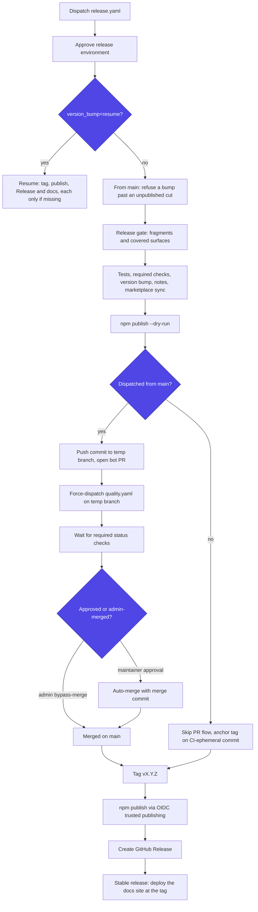

This document records the configuration that gates releases of `bmad-module-ultracode-goal`, and how to cut, finish and roll back a release. It exists so a future maintainer (including future-you) can audit, restore, or extend the pipeline without reverse-engineering GitHub settings. The canonical release path is [`.github/workflows/release.yaml`](../../.github/workflows/release.yaml): manual dispatch, OIDC trusted publishing, no token secrets.

For background on GitHub rulesets vs legacy branch protection, see the [GitHub ruleset docs](https://docs.github.com/en/repositories/configuring-branches-and-merges-in-your-repository/managing-rulesets/about-rulesets).

## Preconditions

Each part of this document needs some of the following. Check them before an incident, not in the middle of one.

- **`gh`, signed in to an account with admin rights on the repository**: every `gh` command. The ruleset and environment writes, the baseline captures and the restore drill need the admin rights.
- **`jq`**: every lookup, capture and restore.
- **Node.js, with `npm ci` run on an up-to-date `main`**: the `node tools/...` commands.
- **`npm`, signed in to an account with publish rights on the package**: `npm dist-tag` and `npm deprecate` in the [dist-tag policy](#dist-tag-policy) and the [rollback playbook](#rollback-playbook). Trusted publishing authenticates only `npm publish`, so these run from a maintainer's own login.
- **npm 11.15.0 or later, and 2FA enabled on that npm account**: `npm trust list` and `npm trust revoke` ([§ npm Trusted Publisher](#npm-trusted-publisher)).

```bash
gh auth status
gh api repos/armelhbobdad/bmad-module-ultracode-goal --jq .permissions.admin   # expect: true
jq --version
node --version
npm whoami                                      # the npm account the npm steps use
npm owner ls bmad-module-ultracode-goal         # expect that account in the list
npm --version                                   # expect 11.15.0 or later for npm trust
npm profile get "two-factor auth"               # expect auth-and-writes or auth-only, not disabled
```

## How a release works

Dispatching `release.yaml` (Actions, Release, Run workflow, with a `version_bump`) runs one job in the `release` environment, so nothing runs until a required reviewer approves (gate 1). In order:

1. **The release gate.** `node tools/changes.js gate` refuses a `version_bump` that the change fragments in `changes/` and the covered surfaces (`tools/covered-surfaces.js`) do not allow, before the tests run and before anything is committed. A stable bump (`patch`, `minor`, `major`) is refused from any ref but `main`, and on `main` a `minor` or `major` is refused while `main` carries an unpublished version ([§ The release gate](#the-release-gate)).
2. **Tests and the required checks.** `npm test` runs on the release runner. A dispatch from `main` then compares the required checks of the live `main-protection` ruleset with the jobs of `quality.yaml` (`tools/check-required-checks.js --ruleset`) and stops when they differ.
3. **Bump and notes.** `npm version` bumps `package.json` and `package-lock.json`, the `Update marketplace.json version` step syncs `.claude-plugin/marketplace.json`, and the fragments added since the last stable tag are rendered into `release_notes.md` (the GitHub Release body), `release_review.md` (the **Review before approving** section of the bot PR) and, for a stable release only, a new block in `CHANGELOG.md`. A pre-publish `npm publish --dry-run` catches package validation failures before anything is pushed.
4. **The bot PR.** From `main`, the release commit goes to a temp branch `release/bot/vX.Y.Z-<run_id>-<run_attempt>` and a bot PR, because the ruleset refuses a direct push to `main`. The run dispatches `quality.yaml` on that branch (pull request events made with `GITHUB_TOKEN` start no workflow), waits for the required checks, then waits for a maintainer to approve or admin-merge the PR (gate 2), and merges it with a merge commit. A run that fails or is cancelled before the PR merges closes it and deletes the temp branch in its last step. From any other ref (a prerelease), the tag goes on the CI commit and `main` does not move.
5. **Tag, publish, Release.** The tag `vX.Y.Z` is pushed, npm publishes through OIDC trusted publishing with provenance under the dist-tag the version step derives from the version (`latest` for a stable version, `alpha`, `beta` or `rc` for a prerelease; any other prerelease id stops the run before anything is written), and the GitHub Release is created from `release_notes.md`.
6. **The docs site.** A stable release then dispatches `docs.yaml`, which deploys the docs site at the new tag ([§ The docs site](#the-docs-site)).

`version_bump=resume`, from `main` only, is the other path: it finishes a cut whose bot PR merged but whose tag, npm publish or GitHub Release is missing, doing only what is missing ([§ Finishing a cut whose bot PR merged](#finishing-a-cut-whose-bot-pr-merged)).

How the dispatch ref forks the pipeline, and where the two paths rejoin to tag and publish:



## Branch Protection on `main`

`main` is gated by a **GitHub repository ruleset** (not legacy branch protection).

**Ruleset:** `main-protection`, applied to `~DEFAULT_BRANCH` (currently `main`), enforcement `active`. Its id was `17255028` at the time of writing (2026-10-17). A ruleset deleted and created again gets a new id, so every command below, and `release.yaml`, looks it up by name ([§ Inspect current state](#inspect-current-state)). The repository variable `RELEASE_RULESET_ID`, which an earlier `release.yaml` read, was deleted on 2026-10-17; nothing reads it.

**Active rules (4):**

| Rule                     | Effect                                                                                                                                                      |
| ------------------------ | ----------------------------------------------------------------------------------------------------------------------------------------------------------- |
| `deletion`               | Branch cannot be deleted.                                                                                                                                   |
| `non_fast_forward`       | Force-push blocked.                                                                                                                                         |
| `pull_request`           | Requires 1 approving review; `require_code_owner_review: false`; `require_extra_approval_for_unattributed_changes: true`; merge, squash and rebase allowed. |
| `required_status_checks` | Merge blocked until every required check passes (names below).                                                                                              |

### Required-check contexts must exist

Branch-protection rulesets can only require status checks that have reported at least once. Open any PR (or dispatch `quality.yaml` manually) so these contexts exist. They are the checks the jobs of `quality.yaml` report, matrix values included, and the `main-protection` ruleset requires every one:

<!-- required-checks:start -->

- `prettier`
- `eslint`
- `markdownlint`
- `lintlang`
- `em-dash`
- `validate (ubuntu-latest)`
- `validate (windows-latest)`
- `python (ubuntu-latest)`
- `python (windows-latest)`
- `docs-links`

<!-- required-checks:end -->

A job reports one check, named by its `name:` or else by its key; a job with a one-dimension matrix reports one per value, `key (value)`. The live ruleset requires all ten (`em-dash` joined it on 2026-10-17). A check a new job reports is added to the ruleset's `required_status_checks` once it has reported (fetch the ruleset, change its `rules`, `PUT` it back, as in [§ Restore from a saved baseline](#restore-from-a-saved-baseline)): until then `node tools/check-required-checks.js --ruleset` fails, and so does a release dispatched from `main`.

**Coupling with `quality.yaml`:** the jobs of that workflow, this list and the ruleset's `required_status_checks` list must agree. A check the ruleset requires that no job reports blocks every pull request, and keeps a release's bot PR waiting until the `Wait for required status checks` step of `release.yaml` times out, after the release commit is pushed. A job the ruleset does not require gates nothing: a pull request can merge with it red. Two checks keep the lists in step:

- On every pull request, `npm run test:docs-links-tool` (the `Test the docs link guard` step of the required `validate` job, and `npm test`) runs `node tools/check-required-checks.js --releasing`. It fails when this list and the checks the jobs report differ, naming each missing and extra check. A pull request that renames, adds or removes a job, or changes a matrix value, therefore updates this list, and the ruleset's list with it.
- A release dispatched from `main` runs `node tools/check-required-checks.js --ruleset` after `Run tests and validation` and before `Bump version`. It reads the live `main-protection` ruleset by name, as the `Wait for required status checks` step does, and stops the run with nothing committed or pushed when the ruleset and the jobs differ, naming each check missing from the ruleset and each extra one.

The tool stops instead of guessing on a job whose check names it cannot derive: a matrix with several dimensions, with `include` or `exclude`, or whose values are not plain strings; an expression in `name:`; a call to a reusable workflow. Teach it the shape in the pull request that adds one. To compare the live ruleset by hand (needs `gh` signed in):

```bash
node tools/check-required-checks.js --ruleset --repo armelhbobdad/bmad-module-ultracode-goal
```

**`strict_required_status_checks_policy: false`**: PR branches are not forced to be up to date with `main` before merging. This avoids constant rebases on a low-traffic repo. Flip to `true` if concurrent merges start producing logical conflicts the checks can't catch. Since `quality.yaml` also runs on every push to `main`, two pull requests merged close together are still checked together on the merged result.

**CODEOWNERS note:** the `pull_request` rule has `require_code_owner_review: false`, and no `.github/CODEOWNERS` file exists, so the only review gate is `required_approving_review_count: 1`. If a CODEOWNERS file and the code-owner requirement are added later, make sure the listed owners can actually approve PRs from other authors: a PR author cannot approve their own PR, so a CODEOWNERS file that lists only a solo maintainer would deadlock every PR that maintainer opens.

**Bypass actors:** `RepositoryRole` actor_id=5 (Admin), `bypass_mode: pull_request`. Admins can bypass the ruleset **only via a pull request**, never via direct push. This preserves `non_fast_forward` and the required-checks gate for the `github-actions[bot]` account, which `release.yaml` uses to push its tags and its release commit (to a temp branch that a pull request merges into `main`). **Do not add a bot-specific bypass**; it would defeat the whole purpose of this ruleset.

### Inspect current state

```bash
REPO=armelhbobdad/bmad-module-ultracode-goal
RULESET_ID=$(gh api "repos/$REPO/rulesets" 2>/dev/null \
  | jq -r 'if type=="array" then (map(select(.name=="main-protection")) | .[0].id // empty) else empty end')
if [ -z "$RULESET_ID" ]; then
  echo "No ruleset named main-protection, or the lookup failed" >&2
else
  gh api "repos/$REPO/rulesets/$RULESET_ID"
fi
```

Every command that needs the ruleset id looks it up by name this way, as the `Wait for required status checks` step of `release.yaml` does, and runs only when the lookup found one. On an error response, `gh api --jq` does not run its filter: it prints the error body, so an id read that way can hold `{"message":"Not Found",...}`. Piped into `jq`, any answer but the list of rulesets gives an empty id instead.

### Restore from a saved baseline

The committed baseline is `release-audits/baselines/baseline-ruleset-main-protection.json` ([§ Baseline snapshots](#baseline-snapshots)). The restore filters that file with `release-audits/baselines/ruleset-put.jq` down to the fields a ruleset `PUT` takes (the filter's comments say which fields it drops and why), prints what the `PUT` would change, and sends the `PUT` only when you answer `y`:

```bash
REPO=armelhbobdad/bmad-module-ultracode-goal
jq -f release-audits/baselines/ruleset-put.jq \
  release-audits/baselines/baseline-ruleset-main-protection.json > /tmp/restore.json

RULESET_ID=$(gh api "repos/$REPO/rulesets" 2>/dev/null \
  | jq -r 'if type=="array" then (map(select(.name=="main-protection")) | .[0].id // empty) else empty end')
if [ -z "$RULESET_ID" ]; then
  echo "No ruleset named main-protection, or the lookup failed: nothing restored" >&2
else
  # What the PUT changes; nothing printed means the live ruleset is the baseline.
  gh api "repos/$REPO/rulesets/$RULESET_ID" \
    | jq -f release-audits/baselines/ruleset-put.jq | diff - /tmp/restore.json
  printf 'PUT /tmp/restore.json to ruleset %s? [y/N] ' "$RULESET_ID"
  read -r ok
  [ "$ok" = y ] && gh api --method PUT "repos/$REPO/rulesets/$RULESET_ID" --input /tmp/restore.json
fi
```

The GitHub ruleset API uses `PUT` (not `PATCH`) for updates, and the `rules` array is replaced wholesale: it is not merged server-side. To change a rule (such as adding a check to the required checks), apply the same filter to the live ruleset instead of the baseline, edit that copy and `PUT` the complete list. When the lookup finds no ruleset named `main-protection` because the ruleset was deleted, recreate it from the baseline with `POST` ([§ Baseline snapshots](#baseline-snapshots)).

## Release Environment

The publish job is gated by a **GitHub [deployment environment](https://docs.github.com/en/actions/deployment/targeting-different-environments/using-environments-for-deployment) with a required-reviewer rule** (not by workflow logic). A job declaring `environment: release` pauses until a listed reviewer clicks "Approve and deploy" in the Actions UI. `github-actions[bot]` cannot self-approve.

**Environment:** `release`, created 2026-06-04. Its id was `16220469047` at the time of writing (2026-10-17); every command below uses the name, which an environment created again keeps.

| Setting                    | Value                                                                                                                                             |
| -------------------------- | ------------------------------------------------------------------------------------------------------------------------------------------------- |
| `wait_timer`               | `0` (no artificial delay; approval is the only gate)                                                                                              |
| `prevent_self_review`      | `false`: see rationale below                                                                                                                      |
| `reviewers`                | `armelhbobdad` (user id `132626034`), 1 approver                                                                                                  |
| `deployment_branch_policy` | `custom_branch_policies: true`, list: `main` only (since 2026-10-17; see [§ Restricting deployments to `main`](#restricting-deployments-to-main)) |
| `can_admins_bypass`        | `true`: an admin can deploy without the approval. It is set on the environment's settings page; the `PUT` below does not take it                  |
| Environment-scoped secrets | `0` (invariant: see "No secret is scoped to this environment" below)                                                                              |

**`prevent_self_review: false` is a correctness constraint, not a loosened control.** Solo-maintainer setups cannot self-approve when this is `true`, so the gate would deadlock on any maintainer-triggered publish. The value flips to `true` the moment a second reviewer joins: do not leave it loose by inertia.

**No secret is scoped to this environment.** The repository holds no secret at any scope (checked 2026-10-17), and OIDC trusted publishing is the only publish credential. The invariant: the `release` env must have zero environment-scoped secrets, and the repo must have zero `NPM_TOKEN`-shaped secrets at any scope. If a future change scopes any secret to this environment, or if an `NPM_TOKEN` secret is ever added at repo scope, re-audit whether the OIDC trusted-publisher path is still in force: the OIDC path is self-sufficient, and a token is a signal that something has regressed off the canonical path.

**Audit command.** Both halves of the invariant are machine-checkable:

```bash
# Repo-scope: expect 0
gh secret list --repo armelhbobdad/bmad-module-ultracode-goal | grep -ci npm_token

# Env-scope: expect {"total_count":0,"secrets":[]}
gh api repos/armelhbobdad/bmad-module-ultracode-goal/environments/release/secrets
```

**Coupling with npm trusted publishing.** The npm trusted publisher binds on four fields: `organization=armelhbobdad`, `repository=bmad-module-ultracode-goal`, `workflow filename=release.yaml`, `environment=release`. The environment name above is load-bearing: any rename here must be accompanied by a matching npm-side update in the same change, or the next publish returns 404.

### Inspect current state

```bash
# Environment itself (reviewers, branch-policy shape, prevent_self_review)
gh api repos/armelhbobdad/bmad-module-ultracode-goal/environments/release

# Allowed deployment branches (expect: one entry, name "main")
gh api repos/armelhbobdad/bmad-module-ultracode-goal/environments/release/deployment-branch-policies

# Environment-scoped secrets (expect: zero)
gh api repos/armelhbobdad/bmad-module-ultracode-goal/environments/release/secrets
```

### Restore / re-apply

Re-applies the environment as `release-audits/baselines/baseline-env-release.json` and `baseline-env-release-branch-policies.json` record it. It is a two-call pattern, because the environment and its branch-policy list are separate resources: creating the environment with `custom_branch_policies: true` alone leaves the allow-list empty, which rejects every dispatch, so the second call is mandatory.

```bash
# (1) Create or update the environment with the required-reviewer gate and a custom branch list.
gh api --method PUT repos/armelhbobdad/bmad-module-ultracode-goal/environments/release --input - <<'JSON'
{
  "wait_timer": 0,
  "prevent_self_review": false,
  "reviewers": [{ "type": "User", "id": 132626034 }],
  "deployment_branch_policy": {
    "protected_branches": false,
    "custom_branch_policies": true
  }
}
JSON

# (2) Add main to the allowed deployment branches.
#     Returns HTTP 422 ("already_exists") if main is already on the list,
#     which is safe to ignore on re-apply. To pre-check:
#     gh api repos/armelhbobdad/bmad-module-ultracode-goal/environments/release/deployment-branch-policies
gh api --method POST repos/armelhbobdad/bmad-module-ultracode-goal/environments/release/deployment-branch-policies --input - <<'JSON'
{ "name": "main" }
JSON
```

### Restricting deployments to `main`

**Applied on 2026-10-17.** Before it, the environment had no branch policy, so a `workflow_dispatch` of `release.yaml` from any branch reached the `release` environment, and its approval was the only thing between that branch and a prerelease publish. With the environment restricted to `main`, a dispatch from another branch is rejected at the job, before any step runs. These are the two calls that applied it, the same as [§ Restore / re-apply](#restore--re-apply):

```bash
gh api --method PUT repos/armelhbobdad/bmad-module-ultracode-goal/environments/release --input - <<'JSON'
{
  "wait_timer": 0,
  "prevent_self_review": false,
  "reviewers": [{ "type": "User", "id": 132626034 }],
  "deployment_branch_policy": {
    "protected_branches": false,
    "custom_branch_policies": true
  }
}
JSON
gh api --method POST repos/armelhbobdad/bmad-module-ultracode-goal/environments/release/deployment-branch-policies --input - <<'JSON'
{ "name": "main" }
JSON
```

The baselines were captured again right after, and gained `baseline-env-release-branch-policies.json` ([§ Baseline snapshots](#baseline-snapshots)).

### Temporarily allowing a feature branch

The environment is restricted to `main`, so a release workflow that declares `environment: release` is rejected from any branch not on the allow-list. For a legitimate validation cut from a feature branch, widen the allow-list for the duration of the test and tighten it back immediately:

```bash
# Allow the feature branch and capture the returned policy id into a shell var.
# Command substitution with --jq .id avoids eyeballing the JSON and pasting
# the id later: if the POST succeeds, $POLICY_ID is ready for the revoke.
POLICY_ID=$(gh api --method POST \
  repos/armelhbobdad/bmad-module-ultracode-goal/environments/release/deployment-branch-policies \
  --input - --jq .id <<'JSON'
{ "name": "feat/my-validation-branch" }
JSON
)
echo "POLICY_ID=$POLICY_ID"  # confirm a numeric id was captured before proceeding

# ... run the validation cut, approve via the reviewer UI, confirm publish ...

# Revoke immediately: the allow-list must return to { main } before leaving the session.
# Quote the expansion so the shell never interprets the id as a redirection token.
gh api --method DELETE \
  "repos/armelhbobdad/bmad-module-ultracode-goal/environments/release/deployment-branch-policies/$POLICY_ID"
```

Leaving a feature branch on the allow-list is an unguarded hole: any later `workflow_dispatch` from that branch would be able to reach the publish path. Treat the revoke as the last step of the validation, not a follow-up.

Only `alpha`, `beta` and `rc` can be cut from a feature branch: the gate step refuses `patch`, `minor` and `major` from any ref but `main`, because a stable release from another branch would publish to `latest` from a commit `main` never gets, and `main`'s next release would render the same fragments into the same version again. A feature-branch prerelease has no bot PR, so nobody reviews its notes before they are published; the run summary shows the **Review before approving** section afterwards.

## npm Trusted Publisher

`release.yaml` publishes to npm through **OIDC trusted publishing**: no `NPM_TOKEN` is read during the publish step, and every published version carries an automatically attached SLSA provenance attestation. For this to work, the npm package `bmad-module-ultracode-goal` has a trusted-publisher entry on npmjs.com that binds on four fields exactly matching what the workflow asserts at run time. A mismatch on any field causes an opaque `404` at publish time: the error ("npm could not match your workflow run") names the failure class, not which of the four fields is wrong. The v2.3.0 publish of 2026-10-16 went through this entry, with provenance.

**Who approves a publish.** The chain proves where a publish came from: this repository, `release.yaml` and the `release` environment. It is not a review by a second person. While the project has one maintainer, the environment's only reviewer is the maintainer who dispatches the run (`prevent_self_review: false`, see [§ Release Environment](#release-environment)), so the environment approval (gate 1) is a self-approval, and gate 2, the bot PR, is cleared by the same maintainer's approval or admin-bypass merge.

| Field             | Value                        |
| ----------------- | ---------------------------- |
| Publisher type    | `GitHub Actions`             |
| Organization/user | `armelhbobdad`               |
| Repository        | `bmad-module-ultracode-goal` |
| Workflow filename | `release.yaml`               |
| Environment       | `release`                    |

**Last checked with `npm trust list`:** not yet checked. Run the command below and replace this line with the date, the npm version and the result (the number of entries, whether their four fields match this table, and their permissions). Check again after any change to the entry, to the name of `release.yaml` or to the `release` environment.

**Inspect current state.** `npm trust list` reads the entry. It needs npm 11.15.0 or later and a maintainer signed in to npm, with 2FA enabled on the account and write access to the package ([§ Preconditions](#preconditions)):

```bash
npm trust list bmad-module-ultracode-goal --json
# expected: one entry with "type": "github", "file": "release.yaml",
# "repository": "armelhbobdad/bmad-module-ultracode-goal" and "environment": "release",
# besides its "id" and its "permissions"
```

Compare those four fields with the table: `type` is the publisher type, `repository` holds the organization/user and the repository, `file` the workflow filename and `environment` the environment. The entry's `id` is what `npm trust revoke --id` takes ([§ Scenario F](#scenario-f-suspected-oidc-compromise--unauthorized-publish)). Without the package name, `npm trust` reads it from the `package.json` in the current directory. The same entry shows on the npm package settings page, **Settings** tab, **Trusted Publisher** section; changing it there needs 2FA re-entry on the maintainer account.

Run `npm trust list` with its output on the terminal, not piped or redirected: when the registry asks for a second factor, npm prompts for it only when both its input and its output are a terminal, and otherwise stops with `EOTP`. With `--json`, a package with no entry prints nothing at all.

**Case-sensitive.** All four fields above use the exact lowercase forms shown; npm's matcher is an exact-string comparison. Do not capitalize on re-registration even if GitHub's UI shows a display form with capitals.

**Rename coupling: the four fields are load-bearing.** Renaming or deleting the `release` GitHub environment, renaming or moving `release.yaml` within `.github/workflows/`, or flipping the extension between `.yaml` and `.yml` each require matching updates in the same PR to: (a) the npm-side Trusted Publisher, (b) the table above, and (c) the `## Releasing` section of `CONTRIBUTING.md` (which names `release.yaml` and the `release` environment). Skipping any of these produces an opaque `404` on the next publish.

**A publish that returns 404.** Open a **three-way comparison**: (1) the `npm trust list` output (or the npm Settings tab), (2) the workflow YAML's `name` / `on` / `jobs.<id>.environment` lines, and (3) the table above. The table is the ground truth: compare both the npm record and the workflow header against it, never the workflow against itself (verifying the workflow against its own header will silently confirm a typo).

**`NPM_TOKEN` is not a credential here: OIDC is the only publish credential.** An incident that needs a credential revoked involves npmjs.com's trusted-publisher config, not a repo secret. `release.yaml` still sets `NPM_TOKEN: ""` explicitly in both the pre-publish dry-run step and the final publish step, as defense-in-depth against a stale token being picked up by npm from the runner env: those literal empty-string assignments are not `secrets.*` reads and stay load-bearing whether or not a secret exists. Both sites carry a `# DO NOT REMOVE` comment so a cleanup pass does not silently delete them; audit with `grep -c 'NPM_TOKEN: ""' .github/workflows/release.yaml` (expect `2`). If an OIDC incident ever forces a last-resort token-based re-publish, adding `NPM_TOKEN` at repo scope is the exception path, not the default: document the flip in the commit body, file an issue for the OIDC incident class that required it, and remove the token again the moment OIDC is restored.

**Fixing a bad registration.** The npm UI exposes both **Edit** and **Delete** on an existing Trusted Publisher entry. Prefer edit for a single-field typo; prefer delete-and-re-add if multiple fields are wrong. A publish that runs between the delete and the re-add returns 404, so freeze publishing first: no `release.yaml` run in progress and no tag in flight. The registry holds one entry per package, so on the CLI a replacement is `npm trust revoke` and then a new registration.

**The publish uses the npm that ships with Node.** `release.yaml` publishes with the npm bundled with the Node version `.nvmrc` selects, installs no other npm, and stops before anything is committed or published when that npm is below 11.5.1, the OIDC trusted-publishing floor. Should a Node line ever ship an npm below it, install one exact npm version before that check, never `@latest`.

## Repo settings: auto-merge and Actions pull requests

```bash
gh api --method PATCH /repos/armelhbobdad/bmad-module-ultracode-goal -f allow_auto_merge=true
gh api --method PUT /repos/armelhbobdad/bmad-module-ultracode-goal/actions/permissions/workflow \
  -f default_workflow_permissions=read -F can_approve_pull_request_reviews=true
```

Both are set (checked 2026-10-17: `allow_auto_merge: true`, `default_workflow_permissions: read`, `can_approve_pull_request_reviews: true`). Without `allow_auto_merge`, `gh pr merge --auto` in the workflow fails. Without `can_approve_pull_request_reviews` ("Allow GitHub Actions to create and approve pull requests" in Settings, Actions, General, **off by default**), the `Open bot PR` step fails with `GraphQL: GitHub Actions is not permitted to create or approve pull requests`. The workflow-level `permissions: pull-requests: write` declaration is necessary but not sufficient; this repo-level toggle gates it independently. `delete_branch_on_merge` is `false`, which is why a bot branch can stay on origin after a queued merge ([§ The bot temp branch after a merge or a failed run](#the-bot-temp-branch-after-a-merge-or-a-failed-run)).

## Health-check labels

The health-check loop's `gh issue create` hard-fails on missing labels (only the per-fingerprint `fp-*` label is guarded with `|| true`). Pre-create the fixed set:

```bash
for L in "health-check:0E8A16" "workflow-improvement:1D76DB" "bug:D73A4A" "friction:FBCA04" "gap:C5DEF5" "duplicate:CFD3D7"; do
  gh label create "${L%%:*}" --repo armelhbobdad/bmad-module-ultracode-goal --color "${L##*:}" 2>/dev/null || true
done
```

## Version-coupling invariant

`package.json` `version` and `.claude-plugin/marketplace.json` `.plugins[0].version` must always be equal. The release workflow enforces this at release time (its `Update marketplace.json version` step); between releases, keep them equal by hand. `npm run test:install` asserts the coupling and fails the quality gate on drift.

## Cutting a Release

The sections below apply to every cut, the steps after the publish included ([§ After the publish](#after-the-publish)).

### Dispatch and the two gates

```bash
git checkout main && git pull --tags
gh workflow run release.yaml --ref main -f version_bump=<alpha|beta|rc|patch|minor|major>
RUN_ID=$(gh run list --workflow=release.yaml --limit 1 \
  --json databaseId --jq '.[0].databaseId')
gh run watch "$RUN_ID"
```

`--ref main` is explicit: any other ref takes the tag-only prerelease path inside `release.yaml`. The run pauses at **two** gates that the maintainer clears in the browser:

1. The `release` environment deployment gate, at job start: "Review deployments", then "Approve and deploy" on the run page.
2. The bot PR, after the required status checks pass: EITHER approve it in the review UI, OR admin-bypass-merge it with the PR merge button. The `Wait for PR approval or admin-bypass merge` step accepts both, and waits 30 minutes. Read its **Review before approving** section and the `CHANGELOG.md` diff first.

### Pre-dispatch: preview the notes and the version bump

Release notes come from the change fragments in `changes/` (one YAML file per user-visible change; the format and the type rule are in [`changes/README.md`](../../changes/README.md)), not from commit subjects. Before dispatching, on an up-to-date `main` with its tags:

```bash
git checkout main && git pull --tags
npm run changes:preview -- --bump <alpha|beta|rc|patch|minor|major>
node tools/release-state.js guard --bump <alpha|beta|rc|patch|minor|major>
node tools/check-required-checks.js --ruleset --repo armelhbobdad/bmad-module-ultracode-goal
```

The preview prints the fragments added since the last stable tag (`git describe --tags --abbrev=0 --match 'v[0-9]*' --exclude '*-*'`), any file in `changes/` to fix, the covered-surface changes against that tag from `tools/covered-surfaces.js` (hard, additive and review groups), the minimum bump with each reason for it, the version the dispatch will produce, the release gate's verdict for that bump, and the exact block the release will write. `node tools/release-state.js guard` gives the verdict of the step that runs before the gate on `main`, which refuses a `minor` or `major` while `main` carries an unpublished version (see [§ The release gate](#the-release-gate)); outside Actions it only prints. `node tools/check-required-checks.js --ruleset` gives the verdict of the check a `main` dispatch runs after its tests. Fix a missing or mistyped fragment by pull request, then preview again. Read the review group as well: a key added to the `gate_eval.py` result is listed there, and one that every invocation prints is a shape change that needs a `breaking` fragment.

Each pull request brings its own fragments, so the preview normally finds nothing missing: the required `em-dash` check runs `npm run changes:pr` on every pull request (see [CONTRIBUTING.md](../../CONTRIBUTING.md#the-pull-request-check)). It fails a pull request that changes the code the package ships (`skills/` outside the dev artifacts `.npmignore` keeps out, `tools/cli/`, `tools/ucg-npx-wrapper.js`) or `.npmignore` with no fragment of its own and no `Changelog: none (<reason>)` line in a commit message, one that removes a covered item no `breaking` fragment on it names, one that adds a covered item no `added` or `breaking` fragment on it covers, and one whose fragments are invalid or edit, rename or copy a released one. A pending fragment a pull request only edits counts only for the covered items it names in backticks. It compares each branch with its own merge base, not with the last stable tag, so the preview and the gate stay the check of the release as a whole: a pull request merged before the check existed, a `Changelog: none` line that was wrong (one line covers a whole branch), a user-visible change in what the check does not read (`package.json`, such as a raised `engines.node` floor or a new runtime dependency, `README.md` or the shipped `docs/`), and a change only the review group reveals are theirs to catch. The bot PR is exempt: its branch is `release/bot/*` of this repository, and its checks run through `workflow_dispatch`, where the step does not run, so a dispatch run's `em-dash` success does not include this check.

Keep `## [Unreleased]` in `CHANGELOG.md` empty. The release inserts the new block directly under it. The gate refuses a stable release that finds text there, before the tests run, and `npm run validate:changes` fails on a pull request that adds some; a note that belongs in the release goes in a fragment.

### The release gate

`release.yaml` runs `node tools/changes.js gate --bump <version_bump>` after `npm ci` and, on `main`, the `Refuse to bump past an unpublished release` step, before the tests and before anything is committed. It refuses the dispatch when:

- the version the `Bump version` step would produce is below the minimum bump, measured with `semver.diff` from the last stable tag (so a `patch` after an unpublished, untagged `3.0.0` gives `3.0.1` and still counts as a major step from the last stable tag);
- that version is below the current one: `npm version` moves a prerelease to a lower id without complaint (`alpha` on `3.0.0-rc.1` gives `3.0.0-alpha.0`);
- a covered item was removed (one of the public surfaces [STABILITY.md](./STABILITY.md) lists, as [`changes/README.md`](../../changes/README.md#which-type) names them: a CLI subcommand or option, a `[workflow]` key of `customize.toml`, a key of the headless emit shape, the skill name or an invocation phrase, a `gate_eval.py` flag, choice, `gate_status`, verdict or printed key), a key of the headless emit shape was added, or a tool minimum in `tools/tool-requirements.yaml` was raised or set for the first time, and no `breaking` fragment names it in backticks;
- a file in `changes/` is not a valid fragment, or a fragment released in the last stable tag was edited, renamed or copied (a released fragment is never read again, so a new change goes in a new file);
- a stable release finds text under `## [Unreleased]` in `CHANGELOG.md`;
- a stable bump (`patch`, `minor` or `major`) is dispatched from a ref other than `main` (the gate step checks this before the tool runs);
- the bump gives a higher major.minor than the version `main` carries while `main` holds that version's release commit (`release: bump to vX.Y.Z`, from a merged bot PR) and npm does not have it: a `major` or `minor` over an unpublished `3.0.0` would cut `4.0.0` or `3.1.0` past it. The `Refuse to bump past an unpublished release` step checks this on `main` before the gate (`node tools/release-state.js guard`), so its message, which names the resume path ([§ Finishing a cut whose bot PR merged](#finishing-a-cut-whose-bot-pr-merged)), comes first. `patch` and the prerelease choices stay allowed, `patch` as the ship-forward when that version cannot be published;
- the release is a major and no fragment is `breaking`;
- the release is a major and the **Status** line of [STABILITY.md](./STABILITY.md) names another major. The file ships in the package as the public contract, so restate it by pull request before the cut: the Status line, the posture sentence under it and the `description` in its front matter (the gate reads the Status line, and `npm run test:changes-tool` checks that the three agree);
- a stable release has no fragment;
- a prerelease cannot reach the minimum (see the next section).

A refused run has committed and pushed nothing: fix the fragments by pull request and dispatch again. There is no override. If the surface diff is wrong, fix `tools/covered-surfaces.js` and its tests.

After `Run tests and validation`, a dispatch from `main` runs `Check the required checks against the ruleset` (`node tools/check-required-checks.js --ruleset`) before `Bump version`. It stops the run, with nothing committed or pushed, when the live `main-protection` ruleset requires a check that no job of `quality.yaml` reports, or does not require one that a job reports, and names each one. Without it, a run whose ruleset requires a check that no job reports would push the release commit and open the bot PR, then wait for that check until the `Wait for required status checks` step times out. Bring the ruleset or `quality.yaml` back in step ([§ Branch Protection on `main`](#branch-protection-on-main)) and dispatch again. A prerelease from another branch opens no bot PR and skips the check.

After the tests, the `Write release notes and CHANGELOG.md` step renders the same fragments. A stable release adds the block under `## [Unreleased]` in `CHANGELOG.md`, leaving every older release byte-identical, and every release writes `release_notes.md` (the GitHub Release body) and `release_review.md` (the **Review before approving** section of the bot PR: a checklist, why the minimum is what it is, the covered-surface changes and the notes). At gate 2, read that section and the `CHANGELOG.md` diff before approving. The full section is added to the run summary: a prerelease cut from a feature branch has no bot PR and so no gate 2, and the summary is the only place its review is shown, after the release is published.

**Size limits.** GitHub refuses a release body over 125,000 characters and a pull request body over 65,536, and drops a step summary over 1 MiB (`RELEASE_BODY_LIMIT`, `PR_BODY_LIMIT` and `STEP_SUMMARY_LIMIT` in `tools/changes.js`). Notes and a review under those limits are written in full. Longer notes are shortened in `release_notes.md` to the version heading, the lead paragraph, every section heading and each entry's scope and first sentence, under a line that says so and links to the full notes: the version's block in `CHANGELOG.md` at its tag, or `changes/` at the tag for a prerelease, which has no block. Should that still not fit, each section gives its number of changes, with the first sentence of each breaking change, then the numbers alone. A longer review keeps the checklist, the reasons at the minimum level and the hard surface changes in the bot PR, counts the rest, and gives the notes in the longest form that fits. The step prints a notice for each file it shortens, and its log shows the shortened release body and the full review in groups while the bot PR waits: GitHub shows the run summary, which keeps the full review, only once the job ends.

### The first cut after a change to the release pipeline

A change to `release.yaml`, to the tools it runs or to the ruleset is first exercised by the next real cut, so make that cut a low-stakes one. Two ways, in order of preference:

- **A prerelease from `main`.** `npm version prerelease` moves only the patch number of a stable version, so from `2.3.0` an `alpha` gives `2.3.1-alpha.0`, which the gate refuses when the minimum bump is `minor` (it names the hand bump). Set the version by hand in a pull request, as the next section describes (for example `2.4.0-alpha.0` in `package.json`, `package-lock.json` and `.claude-plugin/marketplace.json`), merge it, then dispatch `alpha` from `main`: the first alpha published is `2.4.0-alpha.1`, through the whole bot-PR path, and `alpha` points at it until the stable release closes the line ([§ Dist-tag policy](#dist-tag-policy)).
- **A prerelease from a feature branch.** It skips the bot PR, the required-checks comparison and the merge, so it exercises less of the path, and the `release` environment takes deployments from `main` only, so the branch must be allowed for the run ([§ Temporarily allowing a feature branch](#temporarily-allowing-a-feature-branch)).

Then dispatch the stable bump from `main` as usual.

### Prereleases and the RC hand bump

A prerelease writes only `release_notes.md` and leaves `CHANGELOG.md` alone, so its fragments are rendered again, in full, in the stable release's block.

`npm version prerelease` moves only the patch number of a stable version (`2.3.0` with `rc` gives `2.3.1-rc.0`), so a prerelease dispatched from a stable version cannot reach a minor or major minimum. The gate then refuses and names the version to set by hand, such as `3.0.0-rc.0`. Set it in `package.json`, `package-lock.json` and `.claude-plugin/marketplace.json` in a pull request, then dispatch `rc`: the first RC published is `3.0.0-rc.1`. For a major, the same pull request restates [STABILITY.md](./STABILITY.md) as the new major, since an RC ships it too; the gate's message names it when it still names the old one. Dispatch `major` to go from the last RC to `3.0.0`. A release that needs no RC dispatches `major` or `minor` directly.

The npm dist-tag comes from the version, in the `Get new version and previous tag` step of `release.yaml`: `latest` for a stable version, and `alpha`, `beta` or `rc` for a prerelease whose first identifier is that id (`3.0.0-rc.1` goes to `rc`). The dry-run, the publish, the GitHub Release's prerelease flag and the docs deploy all read that one `dist_tag`. The step stops the run, before `marketplace.json` or `CHANGELOG.md` is written, when the version is not a valid semantic version or is a prerelease with any other id, so a version the rule does not know is never published to `latest`. A new prerelease channel therefore takes an edit to that step as well as to the `version_bump` choices and `PREIDS` in `tools/changes.js`.

### Dist-tag policy

`latest` is the only permanent dist-tag. `alpha`, `beta` and `rc` exist only while a prerelease line is open: a line's first cut creates its tag, and the stable release that closes the line removes it in its post-publish steps ([§ After the publish](#after-the-publish)). An `npm install bmad-module-ultracode-goal@alpha` then fails when no alpha line is open, instead of installing a build older than `latest`. The release workflow cannot remove a tag: trusted publishing authenticates only `npm publish`, so `npm dist-tag rm` runs from a maintainer's npm login ([§ Preconditions](#preconditions)). On 2026-10-17 npm still carried `alpha` (`0.1.1-alpha.0`, from 2026-06-04), which predates this policy; the next stable release removes it in the same step.

### The docs site

The docs site (GitHub Pages, built and deployed by [`docs.yaml`](../../.github/workflows/docs.yaml)) shows the latest stable release, not `main`. A merge to `main` does not deploy it: `docs.yaml` has no push trigger. At the end of a stable release (`patch`, `minor` or `major`), once the GitHub Release is created, `release.yaml` dispatches `docs.yaml` with `ref` set to the new tag, so the site changes when the package does. A prerelease leaves the site alone. Pull requests still build the site, in the `docs-links` job of `quality.yaml`, which checks every link of the built output.

The release dispatches the deploy itself because it publishes the GitHub Release with `GITHUB_TOKEN`, and an event made with that token starts no other workflow (`workflow_dispatch` is an exception). The deploy runs on `main`, and `docs.yaml` checks out and builds the tag given in `ref`: by default the `github-pages` environment admits deployments from the default branch only, so a run on the tag itself would be refused at the deploy job.

A failed dispatch does not fail the release, which is already on npm: the run shows a warning with the command to run, and its summary says the site was not deployed. To deploy or redeploy by hand:

```bash
gh workflow run docs.yaml                   # the latest stable tag
gh workflow run docs.yaml -f ref=vX.Y.Z     # a given tag
gh run list --workflow=docs.yaml --limit 1  # find the run to follow
```

With `ref` empty, `docs.yaml` builds the latest stable tag reachable from `main` (`git describe --tags --abbrev=0 --exclude '*-*' --match 'v[0-9]*'`). `ref` also takes a branch or a commit, with a warning: the site then shows docs that no stable release has, until the next stable release deploys over them.

**An urgent docs fix** normally ships as a patch release: merge the fix with a `docs` fragment (see [`changes/README.md`](../../changes/README.md)), preview with `npm run changes:preview -- --bump patch`, then dispatch `version_bump=patch`. The release deploys the site at the new tag.

### The bot temp branch after a merge or a failed run

On a `main` dispatch, the release commit goes to the temp branch `release/bot/vX.Y.Z-<run_id>-<run_attempt>` and a bot PR from it. The name carries the run attempt because **Re-run failed jobs** keeps the run id and builds the release commit again with a new SHA: a branch named after the run id alone would refuse the re-run's push as a non-fast-forward.

**After a merge.** `Auto-merge bot PR` runs `gh pr merge --auto --merge --delete-branch`. When the PR can merge at once, gh merges it and deletes the temp branch. When it cannot merge yet, gh queues an auto-merge and skips the delete, and `delete_branch_on_merge` is off on this repository, so the branch stays on origin after the queued merge. Clearing gate 2 with the PR merge button instead (admin bypass) merges the PR before that step, which is then skipped, and the branch stays on origin too. The v2.3.0 cut left its branch this way, and it was deleted by hand.

**After a failed run.** A run that fails or is cancelled once its temp branch is pushed ends with the step `Close the bot PR and delete its branch after a failed run`:

- an open bot PR is closed with a comment that links the run, and its branch is deleted;
- the branch of a PR that is already closed, or of a run that stopped before it opened its PR, is deleted;
- a merged bot PR and its branch are left alone: `main` then carries the release commit, and the step names the resume path that finishes the cut ([§ Finishing a cut whose bot PR merged](#finishing-a-cut-whose-bot-pr-merged)).

A closed PR keeps the release commit reachable (`refs/pull/<n>/head`), so closing it loses nothing to inspect. To retry, use **Re-run failed jobs** on the run (a flaky check, an approval that timed out) or dispatch `release.yaml` again once the defect is fixed on `main`: either opens a new bot PR, and no second `release: bump to` PR sits next to the old one. Once the bot PR has merged, do neither: **Re-run failed jobs** would cut the version again from the dispatch commit and open a second bot PR against a `main` that already has it. If that step itself fails, its error names the command that finishes the job by hand (`gh pr close <n> --delete-branch` or `git push origin --delete <branch>`).

Either way, check that nothing is left:

```bash
# Expect zero once a cut is fully closed out, published or failed.
git ls-remote --heads origin 'release/bot/*'
gh pr list --state open --search '"release: bump to" in:title'

# Delete a leftover only after confirming its commit is reachable from main.
git fetch origin --quiet
git merge-base --is-ancestor <temp-branch-sha> origin/main \
  && git push origin --delete release/bot/vX.Y.Z-<run_id>-<run_attempt>
```

The tag anchors on the bot PR's merge commit on `main`, not on the temp branch (see the `Create and push tag` step's main-dispatch path), so deleting the branch after the merge orphans nothing. The exception is a pull request that merged into `main` while the release waited for checks and approval (`strict_required_status_checks_policy` is `false`, so the bot PR is not rebased first): the merge commit's tree then holds that pull request, which the published package does not, so the tag goes on the release commit itself, which `main` reaches through the merge commit. The next release then renders that pull request's fragment and checks its surfaces. If the bot PR was squash- or rebase-merged in that case, the release commit is not on `main`, and the run stops before tagging or publishing. The resume path refuses that case too: ship the version forward with `patch` as in [§ Scenario H](#scenario-h-bot-pr-merged-but-the-version-was-not-published), with no tag to delete. The reachability check is what distinguishes this from the tag-orphan case in [§ Scenario D](#scenario-d-tag-exists-but-npm-publish-failed); if the commit is _not_ reachable, the merge did not land: the branch belongs to a run still in progress, or to a failed run whose last step could not finish, and `gh pr list --head <branch> --state all` tells which.

### Finishing a cut whose bot PR merged

Once the bot PR merges, `main` carries the new version, and the tag, the npm publish and the GitHub Release still have to run. When the run stops in that window (the publish fails, a required check fails after an admin merge, the run is cancelled or the tag step fails), dispatch the resume path on `main`:

```bash
gh workflow run release.yaml --ref main -f version_bump=resume
```

It runs in the same `release` job and environment, so gate 1 applies and the npm Trusted Publisher accepts its publish; there is no bot PR and no gate 2. Its `Find what the cut on main still needs (resume)` step runs `node tools/release-state.js resume`, which reads the version `main` carries, the tag, npm, the GitHub Release and the merged bot PR titled `release: bump to vX.Y.Z`. The run then does only what is missing, in the order of a normal cut:

- the tag, on the commit the `Create and push tag` step would use: the bot PR's merge commit, or the release commit (the PR's head) when another pull request merged into `main` while the release waited. A tag already there is kept;
- the publish, unless npm has the version: from the release commit, checked out with its own `npm ci`, after the pre-publish dry-run, under the dist-tag the `Get new version and previous tag` step gives it;
- the GitHub Release, unless it exists, with the notes rebuilt by `tools/changes.js release --notes-only`: `--base` is the stable tag before the version, and `--date` the date of its `CHANGELOG.md` heading (for a prerelease, which has none, the release commit's date);
- for a stable version, the docs deploy.

It skips the gate, the tests, the bump, the commit and the bot PR, and never bumps. When the tag, npm and the Release are all there, it exits without publishing, which also makes a dispatch while the current version is fully released a safe check of the path. Run by hand on an up-to-date `main` checkout, the same command only prints what a resume would do ([§ Scenario H](#scenario-h-bot-pr-merged-but-the-version-was-not-published)). It refuses before anything is written, and says why and, where there is one, what to do instead. The common cases (the header of `tools/release-state.js` lists them all):

- it was dispatched from a ref other than `main`;
- no merged bot PR carries the version `main` holds, or more than one does (a version set by hand, such as `3.0.0-rc.0`, is not a cut: dispatch its channel, which cuts the next one);
- the tag points at another commit (the refusal says how to check it and, if it is wrong, how to delete it);
- the release commit is not on `main`: the bot PR was squash- or rebase-merged while `main` moved;
- npm does not have the version and a required check of the `main-protection` ruleset is not green on the release commit: its newest run counts, and only `success`, `skipped` and `neutral` are green, as in the `Wait for required status checks` step. A check with no run there never started on the release commit, and the refusal names the `gh workflow run quality.yaml --ref <branch>` that starts the checks on the bot PR's branch.

A resumed run that stops after its resume step says what to do in its summary: dispatch `resume` again, which keeps what the run finished and does the rest. A pre-publish dry-run that rejects the release commit's package fails the same way on every dispatch, so ship forward with `patch` then.

While `main` carries such a version, a `minor` or `major` dispatch is refused, and `patch` stays allowed as the ship-forward (see [§ The release gate](#the-release-gate)). [§ Scenario H](#scenario-h-bot-pr-merged-but-the-version-was-not-published) is the recovery as a whole, the ship-forward with `patch` included.

### After the publish

Two steps follow every publish (a resumed cut's included), within an hour of it.

**1. The install smoke test.** Dispatch [`install-smoke.yaml`](../../.github/workflows/install-smoke.yaml) with the exact version just published, not `latest`: right after a publish, `npm view` and `npx` can both still read the previous version from the registry, and a run for `latest` then passes on it.

```bash
gh workflow run install-smoke.yaml --ref main -f version=<version>
# A new run takes a few seconds to be listed, so find it by its title, not
# as the newest run, which can still be the previous one.
RUN_ID=$(gh run list --workflow=install-smoke.yaml --event workflow_dispatch --limit 20 \
  --json databaseId,displayTitle \
  --jq '[.[] | select(.displayTitle=="Install smoke <version>")][0].databaseId // empty')
if [ -z "$RUN_ID" ]; then
  echo "The run is not listed yet: run the lookup again" >&2
else
  gh run watch "$RUN_ID" --exit-status
fi
```

On `ubuntu-latest`, `windows-latest` and `macos-latest`, with Node's minimum, each leg runs `npx --yes bmad-module-ultracode-goal@<version> --version` and fails unless it prints the version `npm view` resolves the input to. A failing leg routes through [§ Scenario B](#scenario-b-bad-version-live-for-hoursdays-users-may-be-installing-it) (deprecate and ship forward). Two dispatches with the same input queue instead of running side by side; the queue is per input, so a `latest` dispatch and one for the version it points at do not queue against each other.

**Where the record lives.** GitHub deletes a run's logs after 90 days, so the workflow's last job attaches `install-smoke.json` (per OS: Node, npm, the version expected and the one `--version` printed, and the result) to the GitHub Release `v<version>`, which does not expire. The run's title (`Install smoke <version>`) and its summary table name the version too. When there is no Release `v<version>` (see [§ Scenario E](#scenario-e-npm-publish-succeeded-but-github-release--tag-push-failed)) or the legs did not resolve the input to one version, that job fails and says so. Read the record without the logs:

```bash
gh release download v<version> --pattern install-smoke.json --output - | jq .
```

The record starts with the next release: v2.3.0's smoke run (2026-10-16, run `38951114729`, passed on all three OSes) predates it, so the v2.3.0 Release holds no `install-smoke.json`.

**2. Dist-tags.** A stable release that closes a prerelease line removes that line's tag ([§ Dist-tag policy](#dist-tag-policy)); after a stable release that closes none, check that no stale tag is left:

```bash
npm view bmad-module-ultracode-goal dist-tags --json
npm dist-tag rm bmad-module-ultracode-goal alpha    # the closed line's tag: alpha, beta or rc
npm view bmad-module-ultracode-goal dist-tags --json
# expected: {"latest":"<version>"}, plus the tag of a prerelease line still open
```

The registry's dist-tag view can lag by minutes after a change, so read it again before acting on an unexpected answer.

## Rollback Playbook

> **NEVER `npm unpublish` a version from v1.0.0 on.** Every version published from v1.0.0 on is immutable by policy, whatever npm's unpublish window allows. The rollback is `npm deprecate` + ship forward.

Scenarios A, B and D to F are recovery paths for a bad publish (Scenario C, the unpublish, is retired: see the note after Scenario B); Scenario G is a meta-recovery path for the release workflow itself; Scenario H finishes a cut that stopped after its bot PR merged. Each scenario follows a five-element shape: **Trigger**, **CLI**, **Expected outcome**, **Constraints**, **Verification**. A compact [cross-reference matrix](#cross-reference-matrix) sits at the end of this section for under-pressure triage. All `gh api` examples in this section use name-based lookups (ruleset by `name=="main-protection"`, environment by literal `release`) so they survive ruleset or environment re-creation.

Placeholder substitutions used throughout:

- `<bad>`: the broken version just published (e.g. `2.4.0`).
- `<previous_good>`: the last known-good version immediately before `<bad>` (e.g. `2.3.0`).
- `<next_version>`: the fix version produced by the next `release.yaml` dispatch (e.g. `2.4.1`).
- `<run-id>`: a GitHub Actions run id visible in the Actions UI and via `gh run list --workflow=release.yaml`.

**A ship-forward cut needs a change fragment.** Every `version_bump=patch` below is a stable release, and the release gate refuses a stable release with no fragment added since the last stable tag. The pull request with the fix adds a `fixed` fragment (see [`changes/README.md`](../../changes/README.md)); preview the cut with `npm run changes:preview -- --bump patch` before dispatching.

### Scenario A: "Bad version published to `latest`, no users yet (within minutes)"

- **Trigger.** Maintainer notices a defect within minutes of publish; `npm view bmad-module-ultracode-goal dist-tags` still shows `<bad>` on `latest`; download count is negligible; no dependents have pinned `<bad>` yet.

  > **Note on cache lag.** `npm view ... dist-tags` reads through a CDN with multi-second to multi-minute eventual consistency. "Still shows `<bad>` on `latest`" is not an authoritative "no users yet" signal. For freshness, cross-check with `npm view bmad-module-ultracode-goal@<bad> time --json | jq '. | to_entries | last'`.

- **CLI.**

  ```bash
  # Flip latest back to the last known-good version.
  npm dist-tag add bmad-module-ultracode-goal@<previous_good> latest

  # Verify the flip landed.
  npm dist-tag ls bmad-module-ultracode-goal

  # Warn anyone who did install <bad> in the meantime.
  npm deprecate bmad-module-ultracode-goal@<bad> "Pulled - use <previous_good> instead"

  # Cut the fix forward via the canonical workflow (OIDC publish, provenance).
  gh workflow run release.yaml --ref main -f version_bump=patch
  ```

- **Expected outcome.** `latest` now resolves to `<previous_good>`; `npm install bmad-module-ultracode-goal@<bad>` emits a deprecation warning; the subsequent patch cut advances `latest` to `<next_version>` cleanly.
- **Constraints.** Valid only while the blast radius is small. If any downstream has already pinned to `<bad>`, Scenario B applies instead: reverting `latest` won't reach those installs.
- **Verification.**

  ```bash
  npm view bmad-module-ultracode-goal dist-tags --json
  # expected: {"latest":"<previous_good>", ...}
  # A prerelease tag (alpha, beta or rc) shows too only while its line is
  # open (see Dist-tag policy).
  ```

### Scenario B: "Bad version live for hours/days, users may be installing it"

- **Trigger.** Defect discovered after `<bad>` has held `latest` long enough that download count is non-zero, or dependents may have already pinned.
- **CLI.**

  ```bash
  # Warn immediately: every install of <bad> now prints this string.
  npm deprecate bmad-module-ultracode-goal@<bad> "Critical bug - use <next_version> instead"

  # Cut the fix forward. A stable version publishes under the `latest`
  # dist-tag (the dist_tag of release.yaml's version step), so no manual
  # `dist-tag add` is needed here.
  gh workflow run release.yaml --ref main -f version_bump=patch
  ```

- **Expected outcome.** `npm install bmad-module-ultracode-goal` starts emitting the deprecation warning; the new patch publishes cleanly; `latest` advances to `<next_version>`.
- **Constraints.** **Do NOT** `npm dist-tag add @<previous_good> latest` in this scenario. Once users may have installed `<bad>`, moving `latest` back splits them across two versions and hides the fix. Ship forward via patch bump.
- **Verification.**

  ```bash
  # Confirm the deprecation message landed on the registry (no install required:
  # `npm install` would mutate the cwd's package.json/package-lock.json).
  npm view bmad-module-ultracode-goal@<bad> deprecated
  # expected: the exact deprecation string set above ("Critical bug - use <next_version> instead")
  ```

**Scenario C (unpublish) is retired.** Versions from v1.0.0 on are never unpublished, and the pre-1.0.0 versions are long past npm's 72-hour unpublish window: a bad version is deprecated and shipped forward (Scenarios A and B).

### Scenario D: "Tag exists but npm publish failed"

- **Trigger.** `release.yaml` pushed the `v<version>` tag (the `Create and push tag` step runs before the npm publish step) and then the publish step failed: OIDC 404, tarball validation error, network drop. `npm view bmad-module-ultracode-goal@<version>` returns 404; `git ls-remote --tags origin v<version>` shows the tag.
- **A cut from `main`.** Its bot PR merged before the tag step ran, so `main` carries `<version>`: follow [§ Scenario H](#scenario-h-bot-pr-merged-but-the-version-was-not-published), whose resume path keeps the tag, publishes `<version>` and creates the GitHub Release. Do not delete the tag and dispatch the same `version_bump` again: that bumps past `<version>`, and a `major` over an unpublished `3.0.0` would cut `4.0.0` (the release workflow refuses `minor` and `major` while `main` carries an unpublished version).
- **CLI (a prerelease cut from a feature branch).** Such a cut has no bot PR and never moves its branch's `package.json`, so a new cut from that branch gives `<version>` again, which npm accepts: it never received it.

  ```bash
  # VERIFY FIRST that npm did NOT publish: a tag-delete after a successful
  # publish would orphan the npm artifact. If this returns a manifest, STOP
  # and go to Scenario E.
  npm view bmad-module-ultracode-goal@<version> 2>&1

  # Clear the tag locally and on origin, then cut <version> again from the
  # branch, with its prerelease id.
  git tag -d v<version>
  git push --delete origin v<version>
  gh workflow run release.yaml --ref <branch> -f version_bump=<alpha|beta|rc>
  ```

- **Expected outcome.** From `main`, as in Scenario H. From a feature branch, the tag is cleared from origin, and the new run pushes it again and publishes `<version>`.
- **Constraints.** Only safe if publish failed. If npm _did_ publish, use Scenario E: tag-deletion after a successful publish leaves the npm artifact without a matching git ref.
- **A version npm never received is not burned.** npm refuses only a version it once had, an unpublished one included. The version of a failed publish is still free, so the recovery publishes that same version instead of skipping to the next one.
- **Why the tag goes before the publish.** The `Create and push tag` step runs before the publish on purpose. A failed publish then leaves a tag on the tree it was packing, and the resume path keeps that tag and picks up there, so it is not an orphan to delete. What stops a `minor` or `major` from cutting past the unpublished version is the `Refuse to bump past an unpublished release` step, not the tag.
- **Verification.**

  ```bash
  # The tag is on origin and npm has the version.
  git ls-remote --tags origin v<version>
  npm view bmad-module-ultracode-goal@<version> version
  # expected: <version>
  ```

### Scenario E: "npm publish succeeded but GitHub Release / tag push failed"

- **Trigger.** Publish succeeded (`npm view bmad-module-ultracode-goal@<version>` returns a manifest) but the GitHub Release or the tag is missing: the `Create GitHub Release` step failed (API rate limit, auth expiry), the run was cancelled after the publish, or someone deleted the tag afterwards. The tag step runs before the publish, so a run that published had pushed its tag.
- **A cut from `main`.** Dispatch the resume path ([§ Scenario H](#scenario-h-bot-pr-merged-but-the-version-was-not-published)). It skips the publish, puts a missing tag where the `Create and push tag` step does, creates a missing GitHub Release with the notes rebuilt from the change fragments, and deploys the docs site for a stable version. The CLI blocks below do the same by hand.
- **CLI: tag recovery.** Tag the commit the `Create and push tag` step uses, found from the merged bot PR, not the run's `head_sha`: that is the commit the release was dispatched from, before the version bump. `tools/release-state.js` applies the tag step's rule, and outside Actions it only prints.

  ```bash
  git checkout main && git pull --tags && npm ci
  # Prints "Tag v<version>: missing; resume tags the <kind> <commit>." (the
  # merge commit, or the release commit when main moved while the release
  # waited) and, for a missing GitHub Release, the --base and --date of its
  # notes; or why a resume would refuse.
  node tools/release-state.js resume --ref refs/heads/main \
    --repo armelhbobdad/bmad-module-ultracode-goal

  git tag -a v<version> <commit> -m "Release v<version>"
  git push origin v<version>
  git show v<version>:package.json | jq -r .version
  # expected: <version>
  ```

  A prerelease cut from a feature branch has no bot PR: its tag marks the release commit the runner built, which no branch holds, so keep that tag.

- **CLI: GitHub Release recovery.** The workflow's `Write release notes and CHANGELOG.md` step writes `release_notes.md` inside the runner; that file is **not** uploaded as an artifact, so it does not exist outside the run. Rebuild the same text from the change fragments on the release commit, or let GitHub regenerate notes from commit subjects.

  ```bash
  # Option A: rebuild the notes from the change fragments, with the <base>
  # and <date> the resume command above printed ("with the notes from <base>
  # dated <date>"): the stable tag before <version>, no longer the last one
  # once the new tag exists, and the date of its CHANGELOG.md heading.
  # --notes-only leaves CHANGELOG.md alone.
  git checkout v<version>
  node tools/changes.js release --base <base> --version <version> \
    --date <date> --notes-only --notes release_notes.md
  gh release create v<version> \
    --notes-file release_notes.md \
    --title "UltraCode Goal (UCG) v<version>"

  # Option B: let GitHub regenerate from commit subjects (loses the curated
  # notes but always works).
  gh release create v<version> \
    --generate-notes \
    --title "UltraCode Goal (UCG) v<version>"
  ```

  A prerelease cut from a feature branch is not one the tool reads (it reads the version `main` carries): its `--base` is `git describe --tags --abbrev=0 --match 'v[0-9]*' --exclude '*-*' v<version>`, and its `--date` the day of the cut (`git log -1 --format=%cs v<version>`).

- **CLI: docs site recovery (stable `<version>` only).** The `Deploy the docs site at the new tag` step runs after `Create GitHub Release`, so it did not run either. Once the tag is on origin, deploy the site as in [§ The docs site](#the-docs-site): `gh workflow run docs.yaml -f ref=v<version>`. The site's version badge is read from `package.json` at build time, so check first that `git show v<version>:package.json` shows `<version>`.
- **Expected outcome.** Tag landed on origin pointing at the correct commit; GitHub Release page reflects the published npm artifact; npm, GitHub and git state are now consistent.
- **Constraints.** **npm state is immutable.** Do NOT try to "clean up" the npm artifact so the release can be re-run from scratch. The npm artifact plus the recovered git state **is** the canonical record: the audit trail is complete with the successful npm publish plus the recovered tag and GitHub Release, not with a clean rerun.
- **Orphaned-commit caveat (a cut from a feature branch).** A cut dispatched from a feature branch leaves the `release: bump to v<version>` commit on no branch: the tag it pushed is that commit's only pointer on origin. This is expected: the tag is the authoritative pointer.
- **Verification.**

  ```bash
  # Tag resolves.
  gh api repos/armelhbobdad/bmad-module-ultracode-goal/git/refs/tags/v<version>

  # GitHub Release exists.
  gh release view v<version>

  # npm and GitHub provenance still match.
  npm view bmad-module-ultracode-goal@<version> --json | jq '.dist.attestations'
  ```

### Scenario F: "Suspected OIDC compromise / unauthorized publish"

- **Trigger (any of).**
  - `npm view bmad-module-ultracode-goal time` shows a publish with a timestamp no maintainer triggered.
  - `npm audit signatures` on a published tarball reports attestation verification failure.
  - A GitHub Actions run shows reviewer approval that was not given.
  - npm support notifies of suspected compromise.
- **Immediate CLI (within minutes of detection).** Revoke the OIDC trust surface before doing anything else. Both routes need a maintainer signed in to npm with 2FA enabled on the account and write access to the package; the CLI also needs npm 11.15.0 or later ([§ Preconditions](#preconditions)).
  - CLI:

    ```bash
    npm trust list bmad-module-ultracode-goal                   # note the entry's id
    npm trust revoke bmad-module-ultracode-goal --id=<id>
    npm trust list bmad-module-ultracode-goal                   # expected: no trust configuration
    ```

  - Web: the package page on npmjs.com, **Settings** tab, **Trusted Publisher** section, **Delete** the registration.
  - Either blocks _all_ OIDC publishes until re-registered, stopping any further unauthorized use of the OIDC path mid-incident.
  - **No maintainer can sign in to npm** (account locked, 2FA lost): neither route works. Contact npm support at once, as under **Coordination CLI** below, and ask them to remove the trusted publisher. Meanwhile `gh workflow disable release.yaml` stops this repository from reaching the publish step ([§ Scenario G](#scenario-g-releaseyaml-disabled-reverted-or-missing-from-main) re-enables it).

- **Audit CLI.**

  ```bash
  # Full publish timeline.
  npm view bmad-module-ultracode-goal time

  # Per-version provenance shape (script-friendly).
  npm view bmad-module-ultracode-goal@<suspect> --json \
    | jq '.dist.attestations'
  # expected shape:
  # {
  #   "url": "https://registry.npmjs.org/-/npm/v1/attestations/bmad-module-ultracode-goal@<suspect>",
  #   "provenance": { "predicateType": "https://slsa.dev/provenance/v1" }
  # }

  # Human-friendly signature-chain check. `npm audit signatures` operates on
  # the cwd's installed dependency tree: running it in an empty dir returns
  # "0 packages have verified attestations", which is a false-clean signal
  # mid-incident. Wrap the install in a throwaway dir, ignore lifecycle
  # scripts (the suspect tarball may be hostile), then audit.
  mkdir -p /tmp/ucg-incident-verify && cd /tmp/ucg-incident-verify
  npm init -y >/dev/null
  npm install --ignore-scripts bmad-module-ultracode-goal@<suspect>
  npm audit signatures
  # expected: "X packages have verified attestations" with attestation count >= 1
  ```

  If `dist.attestations` is missing or the `url` field points somewhere unexpected, the publish bypassed the OIDC path.

- **Coordination CLI.** If a malicious version was actually published, contact `support@npmjs.com` with the version string, the attestation URL, and the Trusted Publisher registration; request a manual takedown. npm support can unpublish outside the 72-hour window for security-compromise cases.
- **Lockdown CLI.**

  ```bash
  # Confirm no unexpected secrets were added to the repo.
  gh api repos/armelhbobdad/bmad-module-ultracode-goal/actions/secrets

  # Confirm the write-access list is unchanged.
  gh api repos/armelhbobdad/bmad-module-ultracode-goal/collaborators

  # Review all workflows for any pull_request trigger type that could run
  # attacker-controlled code with repo secrets (e.g. `types: [opened]`
  # without a trusted-author gate).
  grep -rn "pull_request:" .github/workflows/
  ```

- **Post-incident reactivation.** After audit completes and root cause is identified and patched, re-register the Trusted Publisher via the npm UI with the four fields matching the table in `## npm Trusted Publisher` above (`organization=armelhbobdad`, `repository=bmad-module-ultracode-goal`, `workflow filename=release.yaml`, `environment=release`). Re-verify via an alpha cut (dispatch `release.yaml` from a feature branch, temporarily allowed per `## Release Environment § Temporarily allowing a feature branch` once the environment is restricted to `main`) before any stable release.
- **Blast radius.** Every stable release from v1.0.0 on has users, so a malicious publish reaches them: the `support@npmjs.com` coordination path is load-bearing, not optional.
- **Do-NOT clause: `NPM_TOKEN` rotation is not OIDC incident response.** Do NOT rotate `NPM_TOKEN` as a first response. No token is on the OIDC path; rotating one does nothing to stop an OIDC compromise.
  - If an `NPM_TOKEN` exists at repo scope at the time of an incident (the exception path of § npm Trusted Publisher), revoke it on npmjs.com under **Access Tokens** AND remove it from the repo: `gh secret delete NPM_TOKEN --repo armelhbobdad/bmad-module-ultracode-goal`. A compromised `NPM_TOKEN` is a **separate incident class** from OIDC compromise. **Expected outcomes of the delete command under incident pressure** (read the response before escalating): (a) `Secret deleted` = success, token revoked at repo scope; (b) `could not find secret NPM_TOKEN` (exit 1, 404) = no-op SAFE, the token is already absent, which is the normal state, not a broken scope or auth issue; (c) any `401` / `403` / scope-permission error = investigate before retrying, likely a `gh auth` or permissions issue unrelated to the token's presence. Outcome (b) is the default; outcome (a) only applies during an exception-path window where a temporary token was added. During a window where OIDC is revoked AND an exception-path token is also compromised, there is no valid publish path: the repo enters lockdown until Trusted Publisher is re-registered. Document the flip in the incident post-mortem; do not publish via any stale path.

### Scenario G: "release.yaml disabled, reverted, or missing from main"

- **Trigger.** `release.yaml` is the only release workflow: no other workflow publishes, and none runs on a `v*` tag push. If `release.yaml` is reverted, renamed, moved, or disabled at the repo-settings level (`gh workflow disable release.yaml`) and someone tries to cut a release, **no workflow fires**. Silent no-op until a maintainer checks `npm view` or the Actions UI.
- **Detection.** After any PR that touches `.github/workflows/*`, and before any release attempt, run:

  ```bash
  gh api repos/armelhbobdad/bmad-module-ultracode-goal/actions/workflows \
    --jq '.workflows[] | select(.name=="Release") | {name, state, path}'
  # expected: {"name":"Release","state":"active","path":".github/workflows/release.yaml"}
  ```

  If `state` is not `active` (the GitHub Actions API reports `disabled_manually` when disabled via the UI or `gh workflow disable`), or no matching workflow is returned at all (file renamed, moved, or deleted), Scenario G applies. A full listing, without the filter, shows the five workflows of `.github/workflows/`, all `active` at the time of writing (2026-10-17).

- **Recovery CLI.**

  ```bash
  # Case 1: workflow is disabled but the file is present.
  gh workflow enable release.yaml

  # Case 2: the file is missing or reverted.
  # Revert the offending PR via the normal branch-protection review path.
  # Do NOT hand-edit main: branch protection blocks direct push anyway.
  gh pr view <offending-pr-number>
  # `gh pr revert` opens a NEW revert PR; it does not merge anything itself.
  # Capture the URL it prints, then approve + merge that revert PR through
  # the standard review path before retrying the release.
  gh pr revert <offending-pr-number>
  # After approval (manual review step required by branch protection):
  gh pr merge <revert-pr-number> --squash
  ```

- **Expected outcome.** `release.yaml` is back on `main` with `state: "active"`; next dispatch fires normally.
- **Prevention.** Single-root invariants to spot-check after any workflow-dir PR. The globs below cover both `.yaml` and `.yml` extensions:

  ```bash
  # Any workflow with id-token: write should be a known release/provenance workflow.
  grep -l 'id-token: write' .github/workflows/*.{yaml,yml} 2>/dev/null
  # expected set:
  #   - docs.yaml (GitHub Pages; release.yaml dispatches it after a stable release)
  #   - release.yaml (canonical)

  # No `v*` push trigger should exist in any workflow: release.yaml is workflow_dispatch-only.
  # Scan the 3 lines following each `push:` block for a v* tag pattern.
  grep -A3 -E '^\s*push:' .github/workflows/*.{yaml,yml} 2>/dev/null \
    | grep -E "['\"]v\*['\"]"
  # expected: zero matches.
  ```

- **Escalation path: PR-revert only.** There is no out-of-band emergency hatch. Recovery flows exclusively through the Case 2 PR-revert path above: revert the offending workflow change via `gh pr revert`, merge through branch protection, then retry the release via `release.yaml`. Every release threads through branch protection, code review and the OIDC Trusted Publisher.
- **Constraints.** Branch protection on `main` blocks direct pushes: recovery goes through a PR in every case. Do not attempt to sidestep branch protection to "fix" `release.yaml` faster; the cost of a bad release (a broken audit trail, a commit history that no longer matches what was published) far exceeds the cost of a normal-review PR.

### Scenario H: "Bot PR merged, but the version was not published"

- **Trigger.** A cut dispatched from `main` stopped after its bot PR merged and before it finished: `main`'s `package.json` holds `<version>`, and npm does not have it, or the tag or the GitHub Release is missing. Three ways to get there:
  - the publish failed (an OIDC 404, a registry error) after `Create and push tag` pushed the tag ([§ Scenario D](#scenario-d-tag-exists-but-npm-publish-failed));
  - a maintainer admin-merged the bot PR before the required checks finished and one of them then failed: the `Wait for required status checks` step names the resume path, and the tag, publish and Release steps never run;
  - the run was cancelled, or the tag step failed, between the merge and the publish.

  The run's last step, `Close the bot PR and delete its branch after a failed run`, leaves the merged PR alone and names the resume path in a warning and in the run summary.

- **CLI.**

  ```bash
  # What main carries and what its cut still needs: the bot PR, where the
  # tag goes, whether npm and the GitHub Release have the version and, when
  # npm does not, whether every required check on the release commit is
  # green; or why a resume would refuse. Outside Actions it only prints.
  git checkout main && git pull --tags && npm ci
  node tools/release-state.js resume --ref refs/heads/main \
    --repo armelhbobdad/bmad-module-ultracode-goal

  # A required check that failed after the merge: re-run it from the run page
  # the refusal links, until every required check is green. A check with no
  # run never started on the release commit: run the gh workflow run
  # quality.yaml --ref <branch> the refusal names. Then:
  gh workflow run release.yaml --ref main -f version_bump=resume
  RUN_ID=$(gh run list --workflow=release.yaml --limit 1 \
    --json databaseId --jq '.[0].databaseId')
  gh run watch "$RUN_ID"
  ```

  Approve the `release` environment gate as for any cut. Do not use **Re-run failed jobs** on the stopped run: it cuts the version again from the dispatch commit and opens a second bot PR against a `main` that already has it. If the resumed run stops after its resume step, dispatch `resume` again: it keeps what that run finished. A pre-publish dry-run that rejects the release commit's package fails the same way on every dispatch: ship forward with `patch`, below.

- **Expected outcome.** The same `<version>` is out: tagged, published to npm with provenance under the dist-tag of a normal cut, released on GitHub and, for a stable version, deployed to the docs site, with nothing bumped or committed ([§ Finishing a cut whose bot PR merged](#finishing-a-cut-whose-bot-pr-merged)). The run summary lists what the run did and what was already there.
- **Constraints.** Resume finishes only the version `main` carries, from its merged bot PR, and refuses the cases listed in [§ Finishing a cut whose bot PR merged](#finishing-a-cut-whose-bot-pr-merged). While `main` carries the unpublished version, a `minor` or `major` dispatch is refused: it would cut past it.
- **Fallback: ship forward with `patch`.** When `<version>` cannot be published (a defect in the release commit, a bot PR squash- or rebase-merged while `main` moved), fix `main` by pull request and cut the next patch. The gate, the notes and their compare link all start at the last stable tag, and fragments stay in `changes/` after a release, so a `patch` is enough even for a major: an unpublished `3.0.0` gives `3.0.1` with the same notes, and the gate still counts it a major step from the last stable tag. Delete the unpublished version's tag first if the run pushed one (after `npm view` confirms npm does not have it): with the tag kept, the gate measures from it and finds no fragment. `CHANGELOG.md` then holds both the unshipped `3.0.0` block and the `3.0.1` one; delete the unshipped block by pull request.
- **Verification.**

  ```bash
  npm view bmad-module-ultracode-goal@<version> version
  # expected: <version>
  git fetch origin --tags
  git show v<version>:package.json | jq -r .version
  # expected: <version>
  gh release view v<version> --json tagName,isPrerelease
  npm view bmad-module-ultracode-goal@<version> --json | jq '.dist.attestations'
  # expected: a non-null object
  ```

### Cross-reference matrix

| Scenario | Trigger class                   | Primary CLI verb                                             |
| -------- | ------------------------------- | ------------------------------------------------------------ |
| A        | Fresh bad latest                | `dist-tag` + `deprecate`                                     |
| B        | Stale bad latest                | `deprecate` + ship forward                                   |
| D        | Tag orphan (publish failed)     | `version_bump=resume` (main); `push --delete` (branch)       |
| E        | Post-publish state drift        | `version_bump=resume` (main); `tag -a` + `gh release create` |
| F        | OIDC compromise                 | `npm trust revoke` (or the npm UI) + audit                   |
| G        | `release.yaml` disabled/missing | `workflow enable` / `pr revert`                              |
| H        | Bot PR merged, not published    | `version_bump=resume`; else ship forward with `patch`        |

### Baseline snapshots

The `main-protection` ruleset and the `release` environment are saved as JSON in `release-audits/baselines/`, which git tracks and `.npmignore` keeps out of the package:

- `baseline-ruleset-main-protection.json`: the ruleset, as `GET .../rulesets/<id>` returns it.
- `baseline-env-release.json`: the environment, as `GET .../environments/release` returns it.
- `baseline-env-release-branch-policies.json`: its allowed deployment branches, as `GET .../environments/release/deployment-branch-policies` returns them.
- `ruleset-put.jq`: the filter that turns a ruleset, as a `GET` returns it, into the body of a ruleset `PUT` or `POST`. A capture leaves it alone.

The restore in [§ Restore from a saved baseline](#restore-from-a-saved-baseline) reads the ruleset file through that filter. The files hold no secret or token: besides ids, they name the bypass actor (the Admin role) and the reviewer's public GitHub account.

**Capture.** Run after any maintainer-initiated change to the ruleset or to the `release` environment, **not on a schedule**, and commit the files by pull request. Each capture overwrites the same files, so git history dates them.

```bash
REPO=armelhbobdad/bmad-module-ultracode-goal
DIR=release-audits/baselines
# save <api path> <file>: write the file only when the GET succeeds, so a
# failed call never leaves an empty or error-body baseline behind.
save() {
  local body
  body=$(gh api "repos/$REPO/$1") && printf '%s\n' "$body" > "$DIR/$2"
}
RULESET_ID=$(gh api "repos/$REPO/rulesets" 2>/dev/null \
  | jq -r 'if type=="array" then (map(select(.name=="main-protection")) | .[0].id // empty) else empty end')
if [ -z "$RULESET_ID" ]; then
  echo "No ruleset named main-protection, or the lookup failed: nothing captured" >&2
else
  save "rulesets/$RULESET_ID" baseline-ruleset-main-protection.json
  save environments/release baseline-env-release.json
  save environments/release/deployment-branch-policies baseline-env-release-branch-policies.json
  npx prettier --write "$DIR"   # the JSON layout the format check expects
  git diff --stat -- "$DIR"
fi
```

**Ruleset deleted: POST.** When the ruleset was deleted, not merely edited, the lookup finds no `main-protection` and the restore stops. Check the ruleset list on the repository's **Settings**, **Rules**, **Rulesets** page first: a failed lookup looks the same. Then recreate it from the baseline, with the same filter:

```bash
jq -f release-audits/baselines/ruleset-put.jq \
  release-audits/baselines/baseline-ruleset-main-protection.json > /tmp/restore.json
gh api --method POST repos/armelhbobdad/bmad-module-ultracode-goal/rulesets \
  --input /tmp/restore.json
```

The ruleset gets a new id; no command in this document names one, and `release.yaml` looks the ruleset up by name. Capture again afterwards.

**The `release` environment** is restored with the two calls in [§ Restore / re-apply](#restore--re-apply). Its baselines are the `GET` shape, which those calls do not take. `test/test-releasing-runbook.py` checks on every pull request that their JSON matches the committed baselines, so a capture that changes the environment fails its pull request until that call is updated.

**Restore drill.** A restore is trusted only once it has run. Right after a capture, run the snippet of [§ Restore from a saved baseline](#restore-from-a-saved-baseline) and answer `y` only when its `diff` printed nothing: the `PUT` then writes the ruleset's own state back, so a `200` that changes nothing shows that the API accepts the filtered baseline. Capture again afterwards: `git diff` on the ruleset file should show at most `updated_at`. If the API rejects a field, change `release-audits/baselines/ruleset-put.jq`, which every restore snippet reads, and record that here. The filter drops the null keys a `GET` can give a required check (a null `integration_id`, which a `PUT` refuses with HTTP 422) and keeps every other rule parameter as the `GET` returns it: `do_not_enforce_on_create`, which a `PUT` takes, so a restore sends its saved value instead of leaving it to the server (whether a `PUT` without it resets it is untested: it has been `false` throughout), and two of the `pull_request` rule that this document does not otherwise rely on, `required_reviewers` and `require_extra_approval_for_unattributed_changes`. Run the drill again after any change to the filter, and add a row.

| Date | Target | Filter | Result |
| ---- | ------ | ------ | ------ |
| 2026-10-17 | `PUT` of the unchanged state to `main-protection`, right after the capture that added `em-dash` | `release-audits/baselines/ruleset-put.jq`, which then also dropped `do_not_enforce_on_create` | `200`; the capture after it was identical, `updated_at` included. Two more `PUT`s of the same state tested what the filter dropped: with `do_not_enforce_on_create: false` added, `200`; with a null `integration_id` on one check, `422` (`Invalid property /rules/3: data matches no possible input`), the ruleset unchanged. Since then the filter has kept `do_not_enforce_on_create` (next row) |
| 2026-10-17 | `PUT` of the unchanged state to `main-protection`, after that filter change | `release-audits/baselines/ruleset-put.jq` | `200`; the capture after it was identical, `updated_at` included |
