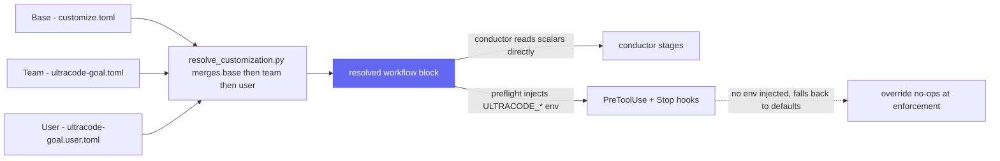

UltraCode Goal is a conductor. It orchestrates the installed BMAD epic toolbox and the TEA gates, composing Claude Code primitives (Auto Mode, Auto Memory, hooks, git branch isolation) and replaces none of them. This page covers the conductor model, the three enforcement layers in depth, the file layout, customization resolution, and why the hooks live where they do.

## The conductor model

The skill owns no implementation logic of its own for building features or running tests. What it owns is the *order*, the *gates*, and the *enforcement*. It delegates:

- **Epic toolbox**: `bmad-sprint-planning`, `bmad-code-review`, `bmad-correct-course`, `bmad-retrospective`, and UCG's own story skills, `ucg-create-story` and `ucg-dev-story`. Those two are adapted from BMAD Method's `bmad-create-story` and `bmad-dev-story`, which 6.12 made opt-in shims and v7 removes, so a run needs no BMAD shim; preflight refuses to launch without them.
- **TEA gates**: `bmad-testarch-framework`, `-ci`, `-test-design`, `-atdd`, `-automate`, `-test-review`, `-nfr`, `-trace`.
- **Claude Code primitives**: each story is driven against a written `/goal`-style condition (only an operator can start a live `/goal`); Auto Mode and ultracode session effort make the unattended run possible; Auto Memory carries learnings forward; hooks enforce invariants; git branches provide isolation and rollback.

Because it is a conductor, the truth of "is this done" lives in the artifacts its delegates produce, not in the conductor's own reasoning. That is the whole design: the model arranges the work, but a script reads the verdict.

## The three enforcement layers

These are the module's non-negotiables. Each exists because the documented mechanics make the intuitive shortcut wrong (see [why](./why-ultracode-goal.md)).

### 1. Deterministic gate truth

`scripts/gate_eval.py` reads TEA's `gate-decision.json` and maps its gate status to a routing verdict (`PASS`/`WAIVED` → advance, `CONCERNS` → defer, `FAIL` → reloop, `NOT_EVALUATED` → escalate). It never re-derives TEA's thresholds and never reads the transcript. A `/goal` evaluator, when an operator runs one, can only see what the run surfaces, it cannot open the gate file, so it is structurally incapable of being the completion authority. The script is. In production, two extra signals can only downgrade an `advance`, never lift a lower verdict; in both profiles a `scope=scoped` tests-ran marker caps a story-moving verdict at `reloop`, so a scoped re-loop sweep can never advance a story. See the [gate model](./gate-model.md) for the full mapping diagram, thresholds, and the fail-closed contract.

### 2. Hooks as invariants

A set of invariants must hold before the runtime lets a tool call through, and none of them can live in memory, which is context the model may or may not weigh:

- **`scripts/hooks/guard_pretooluse.py`** (PreToolUse): inspects each `git commit`/`git push` and enforces seven invariants. It denies the command on a protected branch; denies a `git commit` when no tests-ran marker (`<impl-artifacts>/.tests-ran-<story_id>`) exists for the current story; denies it when that marker's `baseline=<sha>` does not match the SHA the story recorded at start; denies it when the staged index is empty or unreadable; and denies it, when armed with `ULTRACODE_TEST_ARTIFACTS`, while the staged content of a checklist-enumerated acceptance test still contains `test.skip(`. The last two are not about git at all: they run for every tool call while a Cross-Session Recall latch is present. The sixth denies every claude-mem MCP call and any reach into `.claude-mem`, whatever the latch records. The seventh denies tool calls that name the recall store or would change the latch itself, except the skill's own two recall scripts; reading the latch stays allowed. It returns a `deny` decision in the hook JSON and also exits 2 with the reason on stderr so older clients that ignore the JSON still block. The marker, freshness, staged-index, and recall-latch checks fail **closed**, denying on an input they cannot read. Two do not: the protected-branch check fails **open** when `git rev-parse` cannot report a branch, and the un-skip proof is out of scope entirely when `ULTRACODE_TEST_ARTIFACTS` is unset. The protected-branch check is also scoped to the **session's** working directory rather than the repository the command names, so it denies a `git commit`/`git push` aimed at another checkout whenever the session's own repo is on a protected branch.
- **`scripts/hooks/budget_stop.py`** (Stop): counts turns for the current story against `max_turns_per_story`. On overrun it writes an escalation marker and surfaces a message, then **lets the stop proceed**. Its documented limitation: a Stop hook fires only when Claude is already trying to stop, so it cannot interrupt a `/goal` condition mid-turn. Its count advances once per Stop, so it cannot see re-loops spent inside a single response. The conductor reads it before a story starts and before each re-loop, where the gate's re-loop budget turns a re-loop that would exceed the ceiling into `escalate`. The in-condition "stop after N turns" clause binds only an operator's own `/goal`, since the conductor cannot start one. This hook itself is the recorder. The conductor promotes its marker to a `budget-overrun` escalation only when the story's gate escalates it on that count; a story that advances gets a sizing note instead.

Both hooks read their config from env first (so the conductor injects per-run values) and fall back to hardcoded defaults (`main`/`master`, `25`, `ultracode/epic-`). Because of that fallback, a `customize.toml` override **silently no-ops at the enforcement layer** unless the conductor passes it through the hook env, so preflight injects `ULTRACODE_PROTECTED_BRANCHES`, `ULTRACODE_IMPL_ARTIFACTS`, `ULTRACODE_MAX_TURNS`, `ULTRACODE_EPIC_BRANCH_PREFIX`, and `ULTRACODE_TEST_ARTIFACTS`.

### 3. Budget enforcement

Three layers can bound a runaway story, in order of authority: the **in-condition** "…or stop after N turns" clause inside a `/goal` condition (only an operator's own `/goal` condition, which then bounds the session; the conductor cannot start one itself), the **gate re-loop budget** (the conductor reads the hook's turn count before each re-loop, so a `reloop` that would exceed `max_turns_per_story` becomes `escalate`, though that count cannot see re-loops inside one response), and the **Stop hook** as the recorder described above. In a single attended or `-H` session with no operator `/goal`, nothing bounds re-loops spent inside one response; for `drive_epic.py` spawns, the `--session-timeout` wall clock is the backstop. Rollback is git, not `/rewind` (an Epic branch off a protected branch, one implementation commit per green story plus its gate's evidence commit) because `/rewind` checkpoints miss the Bash-driven changes that make up the run.

## File layout

The skill routes from a thin entry point down to just-in-time stage files, deterministic scripts, and an experimental asset:

```
skills/ultracode-goal/
├── SKILL.md                       # Entry point: overview, conventions, run modes,
│                                  #   non-negotiables, the 6-stage table, headless contract
├── customize.toml                 # Config base layer (the [workflow] block)
├── references/                    # Loaded just-in-time
│   ├── ingest-and-scope.md        #   Stage 1
│   ├── preflight.md               #   Stage 2 (the autonomy gate)
│   ├── define-done.md             #   Stage 3
│   ├── execute.md                 #   Stage 4
│   ├── gate.md                    #   Stage 5
│   ├── finalize.md                #   Stage 6
│   └── health-check.md            #   Finalize self-improvement reflection
├── scripts/                       # Deterministic truth (run via `uv`)
│   ├── preflight_check.py         #   mechanical preflight facts + blocker budget
│   ├── gate_eval.py               #   gate status -> verdict (the completion authority)
│   ├── operator_owed.py           #   is a gate FAIL owed only operator evidence? (fail-closed)
│   ├── mutate_check.py            #   mutation harness: attributable-red proof for the story's guards
│   ├── gate_trail.py              #   per-story evidence trail (gate-trail.md) at finalize
│   ├── formalize_check.py         #   readiness kernel behind the /ucg-formalize gate
│   ├── status_render.py           #   read-side render behind /ucg-status
│   ├── red_ids.py                 #   preflight-RED identity (the resolve join key)
│   ├── story_sizing.py            #   decomposition sizing + parent-AC claim reconciliation + split record
│   ├── claim_check.py             #   pre-commit: paths a message names that the staged diff skips
│   ├── drive_epic.py              #   one `claude -p` per story (--max-stories work bound)
│   ├── headless_envelope.py       #   the one five-key headless-envelope adapter
│   ├── health_check_fp.py         #   health-check fingerprint + seen-cache plumbing
│   ├── mem_observation.py         #   Cross-Session Recall write path (write/drain)
│   ├── mem_recall.py              #   Cross-Session Recall latch and read path (latch/filter/unlatch)
│   ├── merge_config.py            #   install-time config merge into shared _bmad
│   ├── merge_customization.py     #   install-time UCG-awareness fragment merge
│   ├── merge_help_csv.py          #   install-time help-CSV merge
│   ├── lib/mem_common.py          #   shared Cross-Session Recall primitives and the run store
│   └── hooks/
│       ├── guard_pretooluse.py    #   commit invariants (PreToolUse)
│       └── budget_stop.py         #   turn budget (Stop)
└── assets/
    ├── module.yaml · module-setup.md · module-help.csv   # install metadata
    └── ucg-awareness/             # shift-left planning customization fragments

skills/ucg-formalize/              # Standalone readiness gate
skills/ucg-resolve/                # Decide-surface for a blocked or escalated run
skills/ucg-status/                 # Read-only status view over a run
                                   #   Top-level siblings of `ultracode-goal`, not children:
                                   #   the IDE's skill loader enumerates one level, so a
                                   #   nested command never resolves. Each stays thin and
                                   #   reaches back into the parent via `{ucg-root}`.
skills/ucg-create-story/           # Story creation the run delegates to (adapted from BMAD)
skills/ucg-dev-story/              # Story implementation the run delegates to (adapted from BMAD)
                                   #   Self-contained, each with its own customize.toml and
                                   #   LICENSE.md; no help-catalog row, since the run, not
                                   #   the operator, invokes them.
```

`SKILL.md` carries the routing and the contract; the `references/*.md` files carry each stage's procedure and testable routing conditions; the `scripts/*.py` files carry the deterministic facts the model cannot fudge (the gate, preflight, readiness kernel, hooks, and the install-time/recall plumbing); three of the top-level sibling skills are the operator-facing surfaces (`ucg-formalize` the standalone readiness gate, `ucg-resolve` the decide-surface for a stopped run, `ucg-status` the read-only run view), and the other two, `ucg-create-story` and `ucg-dev-story`, are the story skills the run delegates to; and the `assets/` hold install metadata and the planning-customization fragments. See [how it works](./how-it-works.md) for the stages.

## Customization resolution

Configuration resolves in three layers, base → team → user, via `resolve_customization.py`:

1. **Base**: `customize.toml` in the skill root (the shipped `[workflow]` block). In an installed project that file is `{project-root}/_bmad/ucg/ultracode-goal/customize.toml`, a verbatim copy of the shipped one; it is the layer to read (every knob is there with its comment), not the layer to edit.
2. **Team**: `{project-root}/_bmad/custom/ultracode-goal.toml`, committed.
3. **User**: `{project-root}/_bmad/custom/ultracode-goal.user.toml`, gitignored by the `*.user.toml` rule that ships in `_bmad/custom/.gitignore`.

   Neither override file is created by any installer, and a missing one is not an error: the resolver loads it non-required and treats absence as an empty table, so a fresh project resolves the base layer alone. You create them when you first need to override something. Do not mistake them for the `config.toml` and `config.user.toml` already sitting in that directory: those are BMAD's own configuration, and a UCG knob written there resolves to nothing.

Merge semantics: **scalars override**, **tables deep-merge**, **arrays append**. At activation the skill runs `resolve_customization.py --skill {skill-root} --key workflow`; if that fails, it resolves the three files itself in the same order. The shipped base layer defines the run's knobs: the TEA/artifact paths (`tea_config_path`, `trace_output_dir`, `implementation_artifacts`, `deferred_work_path`), the git guardrails (`epic_branch_prefix`, `protected_branches`), the turn budget (`max_turns_per_story`; `story_token_budget` remains as a deprecated no-op key), `parallel_max_concurrency` (deprecated no-op since the `--parallel` retirement), the `allowlist_commands`, the two lifecycle hooks (`on_epic_complete`, `on_escalation`), the [health check](./health-check.md) family (`health_check_repo`, `health_check_seen_cache`, `health_check_queue_path`, `health_check_autosubmit`), and the two optional integrations, both off by default: [`cross_session_recall`](./cross-session-recall.md) with its store folder `cross_session_recall_store`, and the third-party [`graphify_integration`](./knowledge-graph-refresh.md). Teams and users override without editing the shipped file. Remember that a budget or branch override only reaches the *enforcement* layer because preflight threads it into the hook env (see layer 2 above).

The three TOML layers merge once, but a branch or budget value then travels two ways: the conductor reads it directly, while the hooks only see it if preflight re-injects it as env:



## Why the hooks live in settings.local.json

The PreToolUse and Stop hooks are auto-merged into `{project-root}/.claude/settings.local.json` (machine-local, gitignored, honored after the workspace trust dialog), not into a committed settings file or memory. The reasoning: these hooks are **enforcement, not context**. A committed hook would impose this module's commit guard on every contributor and every unrelated session in the repo; a hook in memory would not block a commit at all. The machine-local file scopes enforcement to the machine actually running the unattended Epic, and the gitignore keeps it out of shared history. The skill re-merges them every run (idempotently) and asserts they are active before the run goes unattended; it does not assume a prior run left them in place. Because the file is machine-local and executes on your machine, review what is merged; see [SECURITY.md](https://github.com/armelhbobdad/bmad-module-ultracode-goal/blob/main/SECURITY.md).
