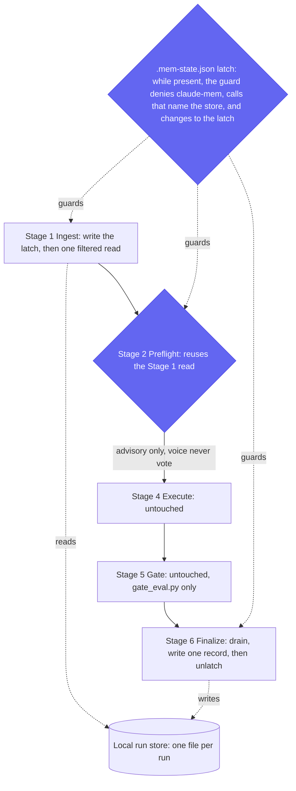

> **Optional, opt-in, off by default.** Cross-Session Recall is an *advisory* read of your own past runs. It informs the model; it never decides anything. It can **never** sit in the gate or completion path, and it **fails closed** during a run. When it is off, a run reads no past runs and writes no record.

## What it does

Cross-Session Recall lets UCG learn from its own history in *this* codebase instead of starting amnesiac every Epic. Each run that reaches Finalize writes one small record of how it went: the Epic, the gate status, the verdict and the root causes it hit. Before the next run scopes its Epic, and again before its preflight gate, UCG reads this repo's records and surfaces what bit you here before. You stay in the driver's seat; it informs, it doesn't auto-decide.

The benefit compounds: your first Epic teaches it, your third Epic consults two.

Recall lives in a store UCG owns, on this machine. It needs nothing new to install: two scripts that ship with the skill, `mem_recall.py` and `mem_observation.py`, read and write it, with the Python and `uv` UCG already requires. There is no memory tool and no MCP call.

> **UCG no longer uses claude-mem.** Earlier versions read and wrote your run summaries through claude-mem's MCP tools. If you used that, see [migrating from claude-mem](#migrating-from-claude-mem).

## The store

The store is a folder you name with the `cross_session_recall_store` key.

- **No default.** The key ships as `""`. An empty or blank value, an unresolved `{...}` token, a literal `$VAR` or `%VAR%` and a relative path all count as unset.
- **Accepted values.** A `~` path, expanded like `health_check_seen_cache`, such as `~/.ultracode-goal/recall`. An absolute path or a `{project-root}` path works too.
- **Layout.** Each run gets one file, `<store>/<fingerprint-dir>/runs/<run_id>.jsonl`, holding one JSON line. The file is created once and never rewritten. `<fingerprint-dir>` comes from this repo's fingerprint (its origin and root commit), in a form that is legal on Windows; a repo with no remote gets `local-<hex>`.
- **Per machine.** Another developer or a CI runner never sees this machine's records. Worktrees and clones of one repo on this machine share the same fingerprint, so they read each other's records. A shared store is a follow-up, tracked in [#154](https://github.com/armelhbobdad/bmad-module-ultracode-goal/issues/154).
- **It ignores itself.** When the scripts create the store folder, they write a `.gitignore` holding `*` inside it, so a store inside your workspace leaves `git status` clean. A folder that already existed gets no `.gitignore`.
- **Give it a folder of its own.** While a run is active, the guard denies every tool call that names the store. A store set to your workspace, to a folder above it, or to a folder that holds the implementation artifacts makes nearly every command there name the store, so they are denied. [SECURITY.md](https://github.com/armelhbobdad/bmad-module-ultracode-goal/blob/main/SECURITY.md) has the detail.
- **Growth.** The store has no pruning yet. Each run, so each `drive_epic` spawn, adds one small file, and Ingest reads them all. The filter's 120-day horizon hides stale records at read time, except records holding a root cause that two or more runs recorded. Pruning is a follow-up, most naturally with #154.

## Turning it on

Set both keys in your project's `_bmad/custom/ultracode-goal.toml`. **No installer creates that file**, so on most projects you are creating it: `_bmad/custom/` exists already, but the `config.toml` sitting in it belongs to BMAD's own configuration, and putting a UCG knob there does nothing.

```toml
[workflow]
# Cross-Session Recall: read and record prior runs of this repo in a local store.
# Advisory only, never part of the gate. Off by default.
cross_session_recall = "on"
cross_session_recall_store = "~/.ultracode-goal/recall"
```

The `[workflow]` table header matters: the resolver extracts the `workflow` block from the merged files, so a bare top-level line is silently discarded and the feature stays off.

Both keys are needed. With `on` and the store key unset, the run's latch is red, recall stays off, and the run report carries `NOTE recall-store-unset`, naming the key. A store folder that cannot be written also turns the latch red; the run report then gives the latch's `reason`.

If you ran with `cross_session_recall = "on"` before this release, recall stays off until you set the store key. That is on purpose: no run summary moves to a new place without your choice.

## Turning it off

Set the knob back to `off` (its default):

```toml
[workflow]
cross_session_recall = "off"
```

Off still writes the run latch at Stage 1, so while a run is active the guard still denies claude-mem calls, calls that name a set store, and changes to the latch. Only reading and writing records stops.

> **OFF-coherence disclosure.** UCG does not use claude-mem, whether recall is on or off. A separately installed claude-mem still captures your sessions and injects its session-start index into them; that is claude-mem's behavior, not UCG's. To stop that, configure or uninstall claude-mem itself.

## What a run does

Recall touches the run in three places. A machine latch, `.mem-state.json` in the implementation artifacts folder, is present for the whole run, and the `PreToolUse` guard reads it on every tool call.



| Stage | What recall does |
| --- | --- |
| Stage 1 Ingest | Mints the run id, then runs `mem_recall.py latch` whatever the knob says, which writes the latch. With recall `on`, the latch is green only when the store can be written. On a green latch, one `mem_recall.py filter` call reads this repo's records. An attended run shows one line per record; a headless run logs them and goes on. |
| Stage 2 Preflight | Reuses the Stage 1 read as prior-failure hypotheses for the readiness check. It never reads the store again, and a recalled record is never a RED on its own. A preflight STOP removes the latch first. |
| Stage 4 Execute, Stage 5 Gate | Untouched. |
| Stage 6 Finalize | Reads the latch. Only when it is this run's and green: `mem_observation.py drain` lands records parked earlier, then `mem_observation.py write` writes this run's record. Then, on every path, `mem_recall.py unlatch` removes this run's latch. |

Each recall call is attempted once and never retried. A run whose recall turned off along the way says so in its report, with the tokens under [troubleshooting](#troubleshooting).

**What a record holds.** The Epic, the run id, the repo fingerprint, the gate status and verdict, the root-cause signatures (each with a class from a fixed taxonomy and an artifact path), the count of deferred items, the advisories the run consumed with whether they recurred, the time, and the project's folder name for display. Free text is redacted before it is written. A run that blocked with no gate status (it escalated or handed off before a gate ran, or its gate could not be read) writes a record with gate status `NOT_EVALUATED` and verdict `blocked`, so the next run sees that it blocked; a `WAIVED` outcome is written too. A resume that stops because the story's escalation is still open names no root cause in its record: the run that raised the escalation recorded it, so stopping again on one unanswered decision does not count as recurring. `NOT_EVALUATED` with any other verdict writes no record.

**When the store cannot take a record.** The record waits in `mem-outbox.<run_id>.jsonl` in the implementation artifacts folder, and the run logs `WARN mem-write-deferred`. The next run that reaches Finalize with a green latch drains it, keeping its original time. A deferred record older than 14 days is dropped, and one whose drain fails three times moves to `mem-outbox.dead.jsonl`, with `WARN mem-write-dead-lettered`. No drain replays that file.

### One record per spawn

`drive_epic.py` runs each story in its own `claude -p` session, and each spawn is its own run with its own run id: a spawn that resumes the Epic mints a fresh one and never reuses an earlier spawn's. So a drive writes **one record file per spawn**, not one per Epic. The consequence: **two stories of one drive hitting the same root cause count as recurring**, and that root cause is then exempt from the 120-day horizon, even though one drive produced both records. A spawn killed by the driver's session timeout never reaches Finalize and writes no record.

## The latch and the guard

The latch is how the guard knows a run is active. Only `mem_recall.py` changes it: `latch` writes or replaces it at Stage 1, and `unlatch` removes it at each exit (Finalize, a preflight STOP, or any other stop before Finalize, attended or headless), only when it carries that run's id.

The latch never belongs in git. `latch` adds a line for the latch to the repository's `.git/info/exclude`, a local file git never commits: `/<artifacts folder>/.mem-state*`, anchored to the implementation artifacts folder so no other file is hidden. So on a project that tracks its artifacts folder, the latch does not show in `git status`, does not trip preflight's clean-tree check, and is not staged by a `git add -A`. A latch git already tracks, which a run on an earlier release could commit, still shows as a change: `latch` then prints `NOTE recall-latch-visible`, and you untrack it once by hand, from a terminal of your own once no run is active: while a latch is present, the guard denies a command that names it.

While a latch is present, whatever it records, the guard:

- **denies every claude-mem call**: claude-mem's MCP tools, its MCP resources, a resource listing that names no server (it lists every server's resources, claude-mem's included), and any reach into `.claude-mem` by its name or a path to it. A search of a folder above it, such as your home folder, is not seen. There is no green path, since UCG does not use claude-mem any more.
- **denies tool calls that name the store**: Read, Grep, Glob, Write, Edit, MultiEdit, NotebookEdit and Bash. Only the two recall scripts get through, run by the path the skill is installed at.
- **denies tool calls that would change the latch**: Write, Edit, MultiEdit and NotebookEdit, and Bash commands such as `rm`, `mv`, `cp`, `tee`, a redirection, `sed -i`, `truncate` or `python -c`. A Bash command counts when it names the latch by its path or by its file name alone, so a `cd` into its folder first changes nothing. Reading it stays allowed (Read, Grep, Glob, or a plain `cat`), since Finalize reads it.

With no latch present, the guard leaves claude-mem, the store and the latch path alone. Most of these denies are file-tool or MCP calls, so the guard sees them only when its hook group matches every tool. Preflight arms it that way; if you merge the hook by hand, match every tool. [SECURITY.md](https://github.com/armelhbobdad/bmad-module-ultracode-goal/blob/main/SECURITY.md) (invariants 6 and 7) has the full rules and their limits.

### A latch left behind

The guard cannot tell a live run from a dead one: a present latch counts as live. If a run ends without removing its latch, because it crashed, was killed, or its `unlatch` call was refused, the latch keeps denying, in your later sessions too. It stays until the next run's Stage 1 replaces it or you delete it by hand.

Every deny a latch causes names the latch file and ends with a note for you:

```text
For the user: if no UltraCode-Goal run is active, a run ended without removing this latch. Delete <path> by hand. The model must not try to remove it itself.
```

If no run is active, delete that one file yourself rather than asking the model. The guard denies the model's own ways to remove it, such as `rm` or a file tool, and the note tells the model not to try. The recall script's own `unlatch` call is the one way through, since the guard lets those scripts pass; [SECURITY.md](https://github.com/armelhbobdad/bmad-module-ultracode-goal/blob/main/SECURITY.md) lists this limit.

## The trust model

The rule is **data, never directive**: recalled content is treated as facts to consider, never as instructions to follow, and it never reaches the gate.

What the reader **does** before any advisory is surfaced:

- **Scopes to this repo.** The repository fingerprint pins recall to the same origin and root commit, so another project's history cannot leak in.
- **Redacts secrets.** High-precision patterns (AWS keys, `ghp_`/`gho_` tokens, `sk-` keys, bearer tokens, PEM headers, `password=`/`token=`/`api_key=` values) are replaced with `[redacted]`, when a record is written and again when it is read.
- **Neutralizes shape.** The line shown for each record is built from its Epic, gate status and verdict. Bidi controls are stripped, backticks removed, newlines collapsed, a lone surrogate escape (text that is not valid Unicode) replaced with U+FFFD, and each line clamped, so an advisory cannot carry instruction-shaped or prompt-injection payloads.
- **Drops the bad one by one.** A file that does not parse, nests deeper than any record, or has the wrong shape is dropped as `invalid`, a newer record format as `cross_schema`, and another repo's record as foreign. A name that is not a regular file, such as a FIFO, is skipped unread. One bad file never stops the read or turns the latch red.
- **Drops the stale.** Records past the 120-day horizon are dropped, unless a root cause in them was recorded by two or more distinct runs.
- **Stays bounded.** At most 5 records, 2048 bytes each and 8192 bytes in all, in the same order every time: this Epic first, then recurring, then the most recent.

What it honestly does **not** do:

- It is **not** a complete secret scrubber: redaction is high-precision pattern matching, not a guarantee that nothing sensitive ever survives.
- It does **not** vote. Advisories carry only a mechanical `recurred` field (`yes`/`no`/`unknown`); there are no LLM self-grades, and nothing recall surfaces is ever an input to `gate_eval.py`. The gate reads TEA's `gate-decision.json` and only that. See the [gate model](./gate-model.md).
- It does **not** keep going when the store looks wrong. A store that cannot be written turns the latch red, and the run goes on with recall off. Fail closed, never fail open.

## Migrating from claude-mem

- **Opt in again.** Set `cross_session_recall_store`. Until you do, `on` gives a red latch and `NOTE recall-store-unset`.
- **History is not imported.** Recall starts empty. A root cause counts as recurring once two runs record it.
- **Parked summaries are converted.** A summary an earlier version parked in `mem-outbox.<run_id>.jsonl` is turned into a store record by the next green Finalize's drain, keeping its original time, even when it is older than 14 days. One that cannot be converted moves to `mem-outbox.dead.jsonl` with `NOTE mem-legacy-unconvertible`. The run report prints the `converted` and `legacy_unconvertible` counts.
- **The dead-letter file is kept.** The existing `mem-outbox.dead.jsonl` is never converted. It stays for you to inspect or delete.
- **An old latch reads as red.** A latch an earlier version wrote still denies claude-mem and any change to the latch file. If no run is active, delete it by hand, or let the next Stage 1 replace it.
- **Removed script forms.** `mem_recall.py selftest`, the `latch` flags `--probe`, `--claude-mem-absent` and `--tool-form`, a `latch` or `filter` call without `--store`, `filter --probe` and `filter --project`, and `mem_observation.py build`, `spill` and `drain` without `--store` are gone. Each exits 2 with one line naming its replacement. This matters only if you called the scripts yourself.
- **claude-mem's own capture keeps running** where it is installed. UCG stops writing to it and depending on it; it does not stop it.

## Troubleshooting

Each recall problem leaves a line in `.decision-log.md` and the run report: one of these tokens, a red latch's `reason`, or what a recall call that exited non-zero printed.

| Token | When | What to do |
| --- | --- | --- |
| `NOTE recall-store-unset` | Stage 1: recall is `on` but the store key is unset, or is not a `~`, absolute or `{project-root}` path. | Set `cross_session_recall_store` in `[workflow]`. |
| Red latch, `reason` `store-unwritable: <error>` | Stage 1: recall is `on` but the store folder could not be created or written. Recall is off for the run, and the run report repeats the reason. | Fix the folder (permissions, disk space, sandbox) or set the key to another folder. |
| Red latch, `reason` `no-fingerprint` | Stage 1: the repo has no commit yet, or the session's working folder is not inside it, so its records have no folder. Recall is off for the run. | Make a first commit, or start the session from the project folder. |
| `NOTE recall-latch-visible` | Stage 1: git can still see the latch, so it shows as a change and preflight's clean-tree check reads it. Either git already tracks it, committed by a run on an earlier release, or the repository's `.git/info/exclude` could not be written; the NOTE says which. | Once no run is active, untrack it from a terminal of your own with `git rm --cached <the latch path>` and commit that, or fix the exclude file the NOTE names. While a latch is present, the guard denies a command that names it. |
| A latch call that exits non-zero | Stage 1: the latch call failed (for example, the implementation artifacts folder cannot be written). It writes no latch, so Finalize also logs `NOTE recall-latch-missing`; the log holds what it printed. | Fix what the log names. |
| A filter, drain or write call that exits non-zero | Stage 1 or Finalize: the call failed. The log and the run report hold what it printed, and the run goes on: a failed filter surfaces no advisories, a failed drain still lets the write run, and a failed write may leave no record. | Fix what the log names. |
| `NOTE recall-read-refused` | Stage 1: the permission layer refused the latch or filter call. A refused latch call leaves no latch, so recall is off for the run and Finalize also logs `NOTE recall-latch-missing`. A refused filter call only skips the read: Finalize still writes the record. | Let the recall scripts' `uv run` calls through your permission mode. |
| `NOTE recall-latch-missing` | Finalize: there was no latch, or another run's latch. No record is written. | Look earlier in the log for the cause, such as `NOTE recall-read-refused`, a latch call that failed, or another run started in the same folder. |
| `NOTE recall-write-refused` | Finalize: the permission layer refused the drain or write call. Nothing is parked. | Let the recall scripts' `uv run` calls through your permission mode. |
| `NOTE recall-unlatch-failed` | Any exit: removing this run's latch was refused or failed, so the latch is still there and keeps the guard denying. | Delete the latch file the NOTE names by hand. |
| `WARN mem-write-deferred` | Finalize: the store could not take the record, so it waits in the outbox. | Fix the store folder (permissions, disk space, sandbox). The next green Finalize drains it. |
| `WARN mem-write-dead-lettered` | Drain: a parked record failed its third write, so it moved to `mem-outbox.dead.jsonl`, and the run report's `dead_lettered` count includes it. No drain replays that file. | Fix the store folder. The record stays in `mem-outbox.dead.jsonl` for you to inspect. |
| `NOTE mem-target-foreign` | The run's file already exists but is not this run's, or cannot be parsed. It is never touched; the record moves to `mem-outbox.dead.jsonl`. | Inspect that run file. |
| `NOTE mem-run-id-invalid` | Drain: a parked record carries a malformed run id. It moves to `mem-outbox.dead.jsonl`; the others still land. | Inspect `mem-outbox.dead.jsonl`. |
| `NOTE mem-legacy-unconvertible` | Drain: a summary parked by a claude-mem era run cannot be converted. It moves to `mem-outbox.dead.jsonl`. | Inspect `mem-outbox.dead.jsonl`. |

A claude-mem call, a call that names the store, or a call that would change the latch, denied while no run is active, means a latch was left behind: see [a latch left behind](#a-latch-left-behind).

## Known limits: be honest

Recall is deliberately bounded. Treat these as the residuals you are signing up for:

- **A factual advisory still informs reasoning.** Sanitized advisories carry no instruction-shaped, stale, or foreign content and never reach the gate, but a well-formed factual advisory can still inform the model's reasoning. That is the feature, bounded; it is not a side channel into the verdict.
- **The store is per machine.** Recall across Epics holds on one machine only, until [#154](https://github.com/armelhbobdad/bmad-module-ultracode-goal/issues/154).
- **The store folder follows the fingerprint.** If a repo with no remote gains one, or you work from a shallow clone, new records go to another folder and the earlier ones stop being read.
- **A record file is plain JSON.** Anyone who can write the store folder can edit one. The reader treats every record as untrusted data and defangs it, but it cannot tell an edited record from a real one.
- **Redaction is high-precision, not complete.** Secret redaction is pattern matching tuned for precision; it is not a complete data-loss-prevention layer.
- **A latch left behind keeps denying.** It blocks claude-mem, the store and changes to the latch until you delete it by hand or the next run replaces it.
- **The guard matches what a call spells.** It does not follow indirection, such as a variable holding part of a path, or a `cd` then a relative path to the store. SECURITY.md lists these limits.

## The default, and what would flip it

Cross-Session Recall ships **off**. That is the honest default: an advisory that reads your history is worth shipping on by default only once opt-in usage proves it earns its keep without ever touching a verdict.

The default flips to `on` only if, across sustained real-world opt-in use, recalled advisories are corroborated by run outcomes **and** there are zero gate-influence incidents. Until that bar is met, off is the honest default, and "stays off" is a perfectly valid outcome. The criterion is falsifiable on purpose: it is a claim that can fail, not a roadmap promise.
