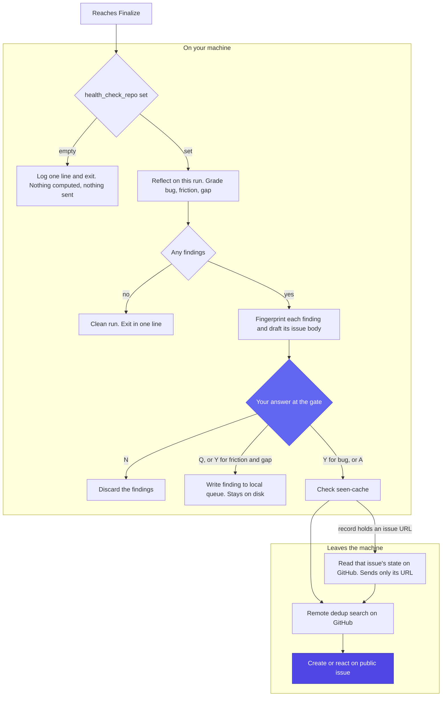

Every UltraCode Goal run that reaches Finalize ends with a health check: a brief self-improvement reflection that audits the run for friction, gaps, or bugs in *this module* and, when it finds something, offers to file a structured GitHub issue. The expected outcome is **zero findings**: a clean run exits in a line. This page covers exactly what it sends, the privacy model, how it dedups, and how to turn it off. The deterministic fingerprint and seen-cache plumbing is [`../skills/ultracode-goal/scripts/health_check_fp.py`](https://github.com/armelhbobdad/bmad-module-ultracode-goal/blob/main/skills/ultracode-goal/scripts/health_check_fp.py).

## What it is, and when it runs

The health check is a reflection step that runs **after every run that reaches Finalize**: a completed Epic, or one that ended in a story escalation. It does **not** run on an early block: a Stage 1 or Stage 2 stop never executed any of the module's run machinery, so there is nothing to audit. Findings are graded into three severities: `bug`, `friction`, and `gap`.

## Exactly what gets sent

A finding is a structured issue with a fixed set of fields plus an Environment table. The Environment table carries:

- Date
- OS
- AI Editor
- Model
- Profile (production / light)
- Run mode (attended / headless)
- Module Version

Explicitly **not** sent: no source code, no Epic content, no secrets. The evidence in a finding is `file:line` citations into **this module's own files** (the skill, its reference stages, and its scripts), never your project's code. A finding is a claim that *the module* could be better, backed by a pointer to the module file that proves it.

## Privacy

Issues are filed publicly on `armelhbobdad/bmad-module-ultracode-goal`. On an **attended** run nothing is sent silently: the health check first drafts each finding's issue body in the run folder, then always **HALTS at a `[Y]` / `[A]` / `[N]` / `[E]` / `[Q]` gate** that shows each finding's title and its full body. Yes files the `bug` findings and keeps the `friction` and `gap` ones on disk, all files every finding, no skips them, edit revises the drafts first, and queue keeps every finding on disk and sends nothing. What you approve is what is sent, except for these changes after the gate: when the defect was fixed before, a line linking to that fix opens the body, and a confirmed regression's title gains `REGRESSION: `; when you choose to file anyway at an open issue with the same fingerprint, the finding takes a more specific defect key, which rewrites its Fingerprint and Defect Key; and when you choose to comment on a matching issue, the comment is written then and shown to you before it is posted.

The boundary below shows the disable path, everything computed on your machine, and the three points where anything crosses to GitHub, all behind a gate: the seen-cache check, which reads the state of an issue already recorded on this machine and sends only that issue's URL, the dedup search, and the issue itself:



The gate that admits anything to the right of the boundary is the `[Y]` or `[A]` approval on an attended run, or the autosubmit opt-in restricted to `bug`-severity findings on a headless run; the Environment table (never source code, Epic content, or secrets) is all that travels with a filed issue.

## Unattended behavior

Headless runs do not have a human at the gate, so by default they **queue findings locally and never live-submit**. Two config knobs (set in `{project-root}/_bmad/custom/ultracode-goal.toml`) change this:

- `health_check_repo = ""`: disables the health check entirely (the target repo doubles as the on/off switch; no target, nothing to run).
- `health_check_autosubmit = true`: opts **bug-severity** findings into live submission on unattended runs. `friction` and `gap` findings are **never** auto-submitted; they always queue regardless of this setting.

The local queue lives at the configured `health_check_queue_path` (by default `{project-root}/_bmad-output/ultracode-goal/improvement-queue/`), which is created when it is missing. `health_check_fp.py queue` writes each finding there as one file, named `hc-ultracode-goal-{stage}-{YYYYMMDD-HHmmss}.md` from the UTC time, and holding the finding's issue body exactly as it was drafted, with no frontmatter. When two findings of one stage are written in the same second, the later names get `-2`, `-3` and so on before `.md`, so no file is overwritten. Whatever the reason a finding stays local (the `[Q]` choice, a headless run, a friction or gap finding, no GitHub CLI, a skipped or failed submission), the health check lists each file it wrote with one sentence giving the reason and the `gh issue create --body-file` command that submits it: on screen in an attended run, in the log in a headless one.

A headless run with `health_check_autosubmit = true` that finds an open issue matching a bug finding has nobody to choose between upvoting, commenting and filing anyway, so it takes the skip choice: the finding is queued with the match as its reason, and nothing is posted.

## Deduplication

Findings are deduped by a deterministic fingerprint so the same defect does not file twice. The fingerprint (`health_check_fp.py fingerprint`) is:

```
fp-XXXXXXX = "fp-" + sha1("{severity}|ultracode-goal/{stage}|"
                          "skills/ultracode-goal/references/{stage}.md|"
                          "{section-slug}|{defect-key}")[:7]
```

The `step_file` component is always the source-repo form `skills/ultracode-goal/references/{stage}.md` regardless of where the skill is installed, so the same defect dedups to the same key across a dev checkout and an installed `_bmad/` tree. `severity` is one of `bug`/`friction`/`gap`; `stage` is one of the six stage names (`ingest-and-scope`, `preflight`, `define-done`, `execute`, `gate`, `finalize`); `section-slug` comes from the heading of the section where the issue occurred: the script checks that the heading is one of that stage file's own, drops its leading `#`s and its numbering (`1b.`, `5a-ii.`, `4-headless.`), lower-cases it and turns each run of other characters into a hyphen, so `1b. Run the formalize readiness check` gives `run-the-formalize-readiness-check`. The `defect-key` is one to four kebab-case words naming the thing the fix would change, in the stage reference's or the script's own words. The script derives it from that name: it drops a file extension and leading dashes, splits the name into words (`gate_status` gives `gate-status`, `gate_eval.py` gives `gate-eval`, `composeStories` gives `compose-stories`) and keeps the last four. So two different defects in one section get two fingerprints, while two reports of one defect that name the same thing get one.

The same hash without `|{defect-key}` is the **section fingerprint**, which every defect of one severity in one section shares. Versions before the defect key used it as the fingerprint, so issues and seen-cache records made by them carry it, and every issue filed now records it in a `` Section fingerprint: `fp-XXXXXXX` `` line of its body. A match on it is only ever a possible match: it never suppresses a finding, and it never closes an issue. Since the script derives the section slug from the heading, the section fingerprint of a defect differs from the fingerprint an issue or a seen-cache record made by version 7.1.0 or earlier carries wherever the slug chosen then differed from the real heading's, as it mostly did. Such an issue then no longer turns up in the section-fingerprint search or the dedup Action's possible-duplicate flag, and a recurrence of its defect is filed without its "Possibly a regression of" line; nothing is silenced, since such a record never suppresses a finding.

Dedup runs at three levels:

1. **Machine-global seen-cache** at the configured `health_check_seen_cache` (by default `~/.ultracode-goal/health-check-seen.json`). The `seen` subcommand reads it into a verdict, and `record` merge-writes one record under a lock on `health-check-seen.json.lock`, through a synced temporary file renamed over the cache, so parallel runs keep each other's records. A missing or empty cache is an empty one; a cache that does not parse is renamed to `health-check-seen.json.corrupt-<UTC time>` rather than erased, so its records can be repaired by hand. Each record carries the issue URL, the action taken (`created` / `reacted` / `commented` / `resolved`), and the date. Only a record tied to a real issue is written: a finding that stays in the local queue records nothing, so a bug a headless run queued is still filed when a later attended run approves it. `created`, `reacted` and `commented` suppress a later sighting of the same fingerprint. `resolved` records that a finding was fixed, and deliberately does **not** suppress: a fresh sighting of a fixed defect is a regression rather than a duplicate, so it is reported and linked back to the original, and `record` never replaces a `resolved` record unless the issue it records tracks that regression. An unrecognized action (an old `queued` record included) does not suppress either, on the same reasoning: a duplicate report is closed automatically, whereas a silenced regression is caught by nothing. A record found only under the section fingerprint never suppresses, and a fix it records is reported as a *possible* regression. The cache is machine-local, so where a record carries a real issue URL the shared source of truth is that issue's own state, which `seen` reads itself (with `gh`, never one found in the current folder, stopped after 10 seconds) in preference to the local record. Only a *completed* close, or a merged pull request, counts as a fix there: an issue closed as *not planned* keeps the local verdict, because that is how the dedup Action closes a duplicate and how a wontfix is closed, and neither is a fix.
2. **Remote search**: before filing, the open issues are searched for the fingerprint, so a finding already filed by another machine is not duplicated. When none carries it, a second search for the section fingerprint offers each issue it finds as a possible match, which only you can confirm.
3. **Server-side**: a repository Action closes duplicates and upvotes the canonical issue, so even a race between two machines converges on one issue. It reads each issue as it is now and runs once at a time per issue, and it closes an issue only in favour of an earlier open one, so two reports filed together never close each other. When a new issue shares only its section fingerprint with an earlier open one, under a different defect key, the Action comments with a link to each and adds the `possible-duplicate` label, and leaves the issue open for a maintainer to decide. GitHub keeps none of the labels a reporter without push access to the repository passes through `gh` or the API, so the Action labels a report that has no `fp-*` label first: it reads the fingerprint and severity from the title, or else from the body's Fingerprint and Severity sections, creates the `fp-*` label and adds each of `health-check`, `workflow-improvement`, the severity and the `fp-*` label the issue lacks, then dedups it like any other. A report that names no fingerprint there is left as it is. One limit: two reports of one fingerprint, both filed without labels at the same moment, can both stay open, since the later one's run can search before the earlier one's run has labeled it.

## Submitting a queued finding manually

A queued finding is a file under the queue directory holding the finding's issue body, exactly as the health check drafted it and, on an attended run, as the gate showed it: its Workflow, Step File, Section, Severity, Fingerprint and `Section fingerprint:` line, Defect Key, the `file:line` evidence and the Environment table. Submit one when you are ready with the two commands the health check printed for it, which carry the run's short description in the title. Filled in by hand, they take their values from the file's sections, and the short description is yours to write. A queue file written by an earlier version opens with YAML frontmatter between two `---` lines: delete it before you pass the file to `--body-file`.

```bash
gh label create "<fingerprint>" --repo <health-check-repo> --color "ededed" \
  --description "Health-check fingerprint dedup key" 2>/dev/null || true
gh issue create --repo <health-check-repo> \
  --title "[health-check][<severity>][<fingerprint>] <workflow>: <short description>" \
  --label "health-check,workflow-improvement,<severity>,<fingerprint>" \
  --body-file <path-to-queued-finding>
```

Keep the full title: the dedup Action reads the fingerprint and severity from it when the issue has no `fp-*` label, and the next reporter's search looks for the fingerprint in titles. Without push access to the repository you can neither create a label nor set one (`gh label create` fails, and its `|| true` hides that), so drop the `gh label create` command and the `--label` line: the dedup Action adds the labels from the title. Nothing is sent until you run these commands. Afterwards, record the new issue with the URL `gh issue create` printed, so this machine does not report the finding again while that issue stays open (`<skill-root>` is the installed `ultracode-goal` skill folder, and `<health_check_seen_cache>` the configured `health_check_seen_cache`, by default `~/.ultracode-goal/health-check-seen.json`):

```bash
uv run <skill-root>/scripts/health_check_fp.py record \
  --fp <fingerprint> --cache <health_check_seen_cache> \
  --issue-url "<the new issue URL>" --action created --date YYYY-MM-DD
```

When the body opens with "Regression of", add `--regression`: the new issue tracks the recurrence, so it replaces the `resolved` record the fix left.

Then retire the queue file: delete it, or move it into a `resolved/` subfolder of the queue directory.

You can also open one through the repository's issue chooser at <https://github.com/armelhbobdad/bmad-module-ultracode-goal/issues/new/choose>. An issue filed that way keeps the template's `health-check` and `workflow-improvement` labels and lacks only the `fp-*` and severity ones, so fill in its Fingerprint and Severity sections (the template's comments give the `health_check_fp.py fingerprint` command that prints the fingerprints, the section slug and the defect key): the dedup Action adds those two from them, and leaves an issue whose Fingerprint still holds the `fp-XXXXXXX` placeholder as it is.
