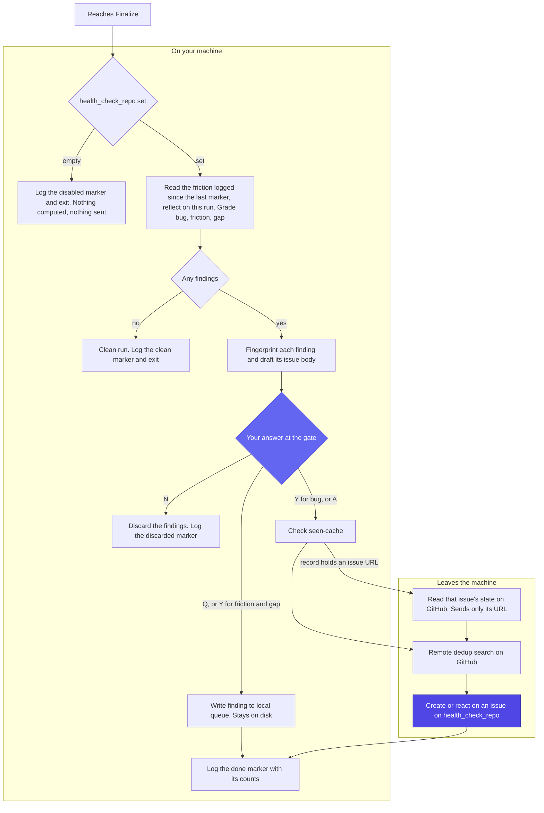

Every UltraCode Goal run that reaches Finalize ends with a health check: a brief self-improvement reflection that audits the run for friction, gaps, or bugs in *this module* and, when it finds something, offers to file a structured GitHub issue. The expected outcome is **zero findings**: a clean run exits in a line. This page covers exactly what it sends, the privacy model, how it dedups, and how to turn it off. The deterministic fingerprint and seen-cache plumbing is [`../skills/ultracode-goal/scripts/health_check_fp.py`](https://github.com/armelhbobdad/bmad-module-ultracode-goal/blob/main/skills/ultracode-goal/scripts/health_check_fp.py).

## What it is, and when it runs

The health check is a reflection step that runs **after every run that reaches Finalize**: a completed Epic, or one that ended in a story escalation. It does **not** run on an early block, a Stage 1 or Stage 2 stop: the next run of that Epic that reaches Finalize, if one does, reports the friction the blocked run logged. As it goes, a run logs each instruction that was unclear, contradictory or silent on its case as a `friction:` line in its decision log; every health check, however it ends, logs one `health-check:` line, and reports the `friction:` lines logged after the last one. So a health check that never finished has its friction reported by the next one too. To report a run's friction now, without waiting for a later run, ask the conductor to run the health check for that run: it reads that run folder's `.decision-log.md`, with no other stage, and reports from the log's `friction:` lines alone. Findings are graded into three severities: `bug`, `friction`, and `gap`.

## Exactly what gets sent

A finding is a structured issue with a fixed set of fields plus an Environment table. The Environment table carries:

- Date
- OS
- AI Editor
- Model
- Profile (production / light)
- Run mode (attended / headless)
- Module Version

Explicitly **not** sent: no source code, no Epic content, no secrets. The evidence in a finding is `file:line` citations into **this module's own files** (the skill, its reference stages, and its scripts), never your project's code. A finding is a claim that *the module* could be better, backed by a pointer to the module file that proves it.

## Privacy

Issues are filed on the configured `health_check_repo` with your own GitHub account, and on the default, `armelhbobdad/bmad-module-ultracode-goal`, they are public. On an **attended** run nothing is sent silently: the health check first drafts each finding's issue body in the run folder, then always **HALTS at a `[Y]` / `[A]` / `[N]` / `[E]` / `[Q]` gate** that shows each finding's title and its full body and asks "Submit these findings as issues on `<health_check_repo>`, filed with your GitHub account?", saying public issues on the default and, for any other repository, that they are public if it is. Yes files the `bug` findings and keeps the `friction` and `gap` ones on disk, all files every finding, no skips them, edit revises the drafts first, and queue keeps every finding on disk and sends nothing. A finding about the health check itself (stage `health-check`) is queued, never posted, whatever you choose but no. What you approve is what is sent, except for these changes after the gate: when the defect was fixed before, a line linking to that fix opens the body, and a confirmed regression's title gains `REGRESSION: `; when you choose to file anyway at an open issue with the same fingerprint, the finding takes a more specific defect key, which rewrites its Fingerprint and Defect Key; and when you choose to comment on a matching issue, the comment is written then and shown to you before it is posted.

The boundary below shows the disable path, everything computed on your machine, and the three points where anything crosses to GitHub, all behind a gate: the seen-cache check, which reads the state of an issue already recorded on this machine and sends only that issue's URL, the dedup search, and the issue itself:



The gate that admits anything to the right of the boundary is the `[Y]` or `[A]` approval on an attended run, or the autosubmit opt-in restricted to `bug`-severity findings on a headless run.

## Unattended behavior

Headless runs do not have a human at the gate, so by default they **queue findings locally and never live-submit**. Two config knobs change this:

- `health_check_repo = ""`: disables the health check entirely (the target repo doubles as the on/off switch; no target, nothing to run). Each run it skips still logs its `disabled` marker, which closes the `friction:` entries logged so far: turning the check back on reports only friction logged after that. Finalize lists those entries in the run's addendum first, so they are still on record.
- `health_check_autosubmit = true`: opts **bug-severity** findings into live submission on unattended runs. `friction` and `gap` findings are **never** auto-submitted; they always queue regardless of this setting, as does a finding about the health check itself.

Set them in your project's `_bmad/custom/ultracode-goal.toml`, or for yourself alone in `ultracode-goal.user.toml` beside it, under the `[workflow]` table header. To turn the health check off:

```toml
[workflow]
# Health check off: no target repository, nothing to run.
health_check_repo = ""
```

The `[workflow]` table header matters: the resolver extracts the `workflow` block from the merged files, so a bare top-level line is silently discarded and the knob keeps its default.

**To send findings to another repository**, set `health_check_repo` to it under the same header (`OWNER/REPO`, or `HOST/OWNER/REPO` on a host other than github.com, such as a GitHub Enterprise Server host: log in to that host first, with `gh auth login --hostname HOST`, writing HOST in lower case and without a leading `www.`, as `gh` reads the host of a repository), and set that repository up as the default one is: create the labels `health-check`, `workflow-improvement`, `bug`, `friction`, `gap`, `duplicate` and `possible-duplicate` there, and copy two files into it unchanged, the issue template [`.github/ISSUE_TEMPLATE/workflow-health-check.md`](https://github.com/armelhbobdad/bmad-module-ultracode-goal/blob/main/.github/ISSUE_TEMPLATE/workflow-health-check.md) and the dedup Action [`.github/workflows/health-check-dedup.yaml`](https://github.com/armelhbobdad/bmad-module-ultracode-goal/blob/main/.github/workflows/health-check-dedup.yaml), which reads its repository from the run. Without the labels the first create fails and the retry files the issue unlabeled; without the Action nothing labels it or closes a duplicate. On a host other than github.com, the Action runs only once GitHub Actions is on there, its `runs-on` names one of the host's runners, the host can reach `actions/github-script` at the commit the Action pins, and those runners can run the Node version that commit's `action.yml` names in `runs.using`. Set the project's own `health_check_seen_cache` too: the cache keys each record by fingerprint alone, so two projects that share it and file to different repositories would block or overwrite each other's records.

**To let autosubmit post unattended**, allow the four `gh` commands a submission runs. Without an allow rule, each is left to Claude Code's permission check: under Auto Mode the classifier decides whether it runs, and in a mode that asks first, such as `drive_epic.py`'s default `acceptEdits`, nobody is there to answer, so the call is refused and the finding is queued with a reason that says a `gh` call was refused. Add them to `allowlist_commands` under the same `[workflow]` header, not a second one: TOML refuses a table declared twice, and the resolver then rejects the whole file. Arrays append to the shipped list, and preflight writes each entry as an allow rule in `.claude/settings.local.json`. The whole file then reads:

```toml
[workflow]
health_check_autosubmit = true
allowlist_commands = ["gh auth status", "gh issue list", "gh label create", "gh issue create"]
```

These rules outlast the run: they stay in `.claude/settings.local.json` and apply to every later session in the project, so any agent working there can then create issues and labels on any repository without asking. To keep the three that take a repository to the health-check repository, scope them with it. Every `gh` command the health check runs puts `--repo` right after its subcommand, so the narrower rules still match:

```toml
[workflow]
health_check_autosubmit = true
allowlist_commands = ["gh auth status", "gh issue list --repo <health_check_repo>", "gh label create --repo <health_check_repo>", "gh issue create --repo <health_check_repo>"]
```

An override written for 7.3.0 or earlier allows `gh search issues`, which the health check no longer runs: it searches with `gh issue list`, whose `--repo` also takes a host. In the `[workflow]` override, replace `"gh search issues"` with `"gh issue list"` (or `"gh search issues --repo <health_check_repo>"` with `"gh issue list --repo <health_check_repo>"`), and delete the rule preflight wrote for the old entry, `Bash(gh search issues:*)` or `Bash(gh search issues --repo <health_check_repo>:*)`, from `.claude/settings.local.json`.

When you turn autosubmit off, remove the entries, then delete the rules preflight wrote for them, such as `Bash(gh issue create:*)`, from `.claude/settings.local.json` yourself: preflight only adds rules.

The local queue lives at the configured `health_check_queue_path` (by default `{project-root}/_bmad-output/ultracode-goal/improvement-queue/`), which is created when it is missing. `health_check_fp.py queue` writes each finding there as one file, named `hc-ultracode-goal-{stage}-{YYYYMMDD-HHmmss}.md` from the UTC time, and holding the finding's issue body exactly as it was drafted, with no frontmatter. When two findings of one stage are written in the same second, the later names get `-2`, `-3` and so on before `.md`, so no file is overwritten. Whatever the reason a finding stays local (the `[Q]` choice, a headless run, a friction or gap finding, a finding about the health check itself, no GitHub CLI, a refused `gh` call, a skipped or failed submission), the health check lists each file it wrote with one sentence giving the reason and the commands that submit it, which `health_check_fp.py queue` prints with every argument quoted: on screen in an attended run, in the log in a headless one.

A headless run with `health_check_autosubmit = true` that finds an open issue matching a bug finding has nobody to choose between upvoting, commenting and filing anyway, so it takes the skip choice: the finding is queued with the match as its reason, and nothing is posted.

## Deduplication

Findings are deduped by a deterministic fingerprint so the same defect does not file twice. The fingerprint (`health_check_fp.py fingerprint`) is:

```
fp-XXXXXXX = "fp-" + sha1("{severity}|ultracode-goal/{stage}|"
                          "skills/ultracode-goal/references/{stage}.md|"
                          "{section-slug}|{defect-key}")[:7]
```

The `step_file` component is always the source-repo form `skills/ultracode-goal/references/{stage}.md` regardless of where the skill is installed, so the same defect dedups to the same key across a dev checkout and an installed `_bmad/` tree. `severity` is one of `bug`/`friction`/`gap`; `stage` is one of the six stage names (`ingest-and-scope`, `preflight`, `define-done`, `execute`, `gate`, `finalize`), or `health-check` for a defect in the health check's own instructions or in a script or command it runs, which is never posted: it goes to the local queue unless you discard it, so the run's last step never files a report about itself, which a defect in that filing would call for again.

`section-slug` comes from the heading of the section where the issue occurred. The script checks that the heading is one of that stage file's own, then:

1. drops its leading `#`s;
2. folds it: NFKD, the Unicode compatibility decomposition, then no combining mark, so an accented letter gives its base letter and a ligature, a superscript or a full-width form gives its plain characters (a letter NFKD cannot split, such as `ß`, `ø`, `ł`, `æ`, `œ` or `ı`, stays as it is);
3. drops its numbering (`1b.`, `5a-ii.`, `4-headless.`);
4. lower-cases it and turns each run of characters that are not ASCII letters or digits into a hyphen.

So `1b. Run the formalize readiness check` gives `run-the-formalize-readiness-check`, `Résumé du run` gives `resume-du-run`, `Phase ² final` gives `phase-2-final`, `１. Run the gate` gives `run-the-gate` and `Straße` gives `stra-e`.

The `defect-key` is one to four kebab-case words naming the thing the fix would change, in the stage reference's or the script's own words. The script derives it from that name:

1. folds it as the slug's;
2. trims from both ends, in any layering, the whitespace and the edge characters: backticks, straight and curly quotes, `*`, the brackets `()[]{}<>`, `.`, `,`, `;`, `!` and `?`;
3. keeps the last path component (after `/` or `\`);
4. drops a trailing location: a `:N`, then up to two more `-N` or `:N`, then an optional `:` or `-` (`:42`, `:42-50`, `:42:7:`, `:42:7-12`); a lone `:`; or a GitHub anchor, which is an optional `?plain=1`, then `#L42`, an optional column `C7` and an optional range `-L50`, `-L50C3` or `-50` (`#L42`, `#L42-L50`, `#L42C7-L50C3`, `?plain=1#L42`);
5. trims the whitespace and the edge characters again, and repeats steps 4 and 5 until the name stops changing;
6. drops a known file extension, then leading dashes and underscores;
7. splits the rest into words at whitespace, `_`, `-`, `.` and each lower-case letter followed by an upper-case one;
8. drops every character that is not an ASCII letter or digit, a letter NFKD cannot split included;
9. lower-cases the words and keeps the last four.

For example, `gate_status` gives `gate-status`; `` `scripts/gate_eval.py:42:7` ``, `` `gate_eval.py`:42 ``, `` **`gate_eval.py`** ``, `“gate_eval.py”`, `(gate_eval.py)`, `gate_eval.py:42:7:`, `gate_eval.py#L42C7-L50C3` and `` `gate_eval.py:42`: `` all give `gate-eval`, and `gate.md?plain=1#L42` gives `gate`; `composeStories` gives `compose-stories`, `HTTP2Client` gives `http2client`, `ÉtatMachine` gives `etat-machine`, `fileLoader` gives `file-loader` and `Straße` gives `strae`. A name with no ASCII letter or digit left, one written in another alphabet included, yields no word, and the script refuses it. So two different defects in one section get two fingerprints, while two reports of one defect that name the same thing get one.

The same hash without `|{defect-key}` is the **section fingerprint**, which every defect of one severity in one section shares. Versions before the defect key used it as the fingerprint, so issues and seen-cache records made by them carry it, and every issue filed now records it in a `` Section fingerprint: `fp-XXXXXXX` `` line of its body. A match on it is only ever a possible match: it never suppresses a finding, and it never closes an issue. Since the script derives the section slug from the heading, the section fingerprint of a defect differs from the fingerprint an issue or a seen-cache record made by version 7.1.0 or earlier carries wherever the slug chosen then differed from the real heading's, as it mostly did. Such an issue then no longer turns up in the section-fingerprint search or the dedup Action's possible-duplicate flag, and a recurrence of its defect is filed without its "Possibly a regression of" line; nothing is silenced, since such a record never suppresses a finding.

Dedup runs at three levels:

1. **Machine-global seen-cache** at the configured `health_check_seen_cache` (by default `~/.ultracode-goal/health-check-seen.json`). The `seen` subcommand reads it into a verdict, and `record` merge-writes one record under a lock on `health-check-seen.json.lock`, through a synced temporary file renamed over the cache, so parallel runs keep each other's records. A missing or empty cache is an empty one; a cache that does not parse is renamed to `health-check-seen.json.corrupt-<UTC time>` rather than erased, so its records can be repaired by hand. Each record carries the issue URL, the action taken (`created` / `reacted` / `commented` / `resolved`), and the date. `seen` is given the configured `health_check_repo` and reads a record of an issue on another repository as no record, so that record neither suppresses a finding nor links its body to that issue; `record` still keys the cache by fingerprint alone, so a project that files to another repository sets its own `health_check_seen_cache`. Only a record tied to a real issue is written: a finding that stays in the local queue records nothing, so a bug a headless run queued is still filed when a later attended run approves it. `created`, `reacted` and `commented` suppress a later sighting of the same fingerprint. `resolved` records that a finding was fixed, and deliberately does **not** suppress: a fresh sighting of a fixed defect is a regression rather than a duplicate, so it is reported and linked back to the original, and `record` never replaces a `resolved` record unless the issue it records tracks that regression. An unrecognized action (an old `queued` record included) does not suppress either, on the same reasoning: a duplicate report is closed automatically, whereas a silenced regression is caught by nothing. A record found only under the section fingerprint never suppresses, and a fix it records is reported as a *possible* regression. The cache is machine-local, so where a record carries a real issue URL the shared source of truth is that issue's own state, which `seen` reads itself (with `gh`, never one found in the current folder, stopped after 10 seconds) in preference to the local record. Only a *completed* close, or a merged pull request, counts as a fix there: an issue closed as *not planned* keeps the local verdict, because that is how the dedup Action closes a duplicate and how a wontfix is closed, and neither is a fix.
2. **Remote search**: before filing, the open issues are searched for the fingerprint, so a finding already filed by another machine is not duplicated. When none carries it, a second search for the section fingerprint offers each issue it finds as a possible match, which only you can confirm.
3. **Server-side**: a repository Action closes duplicates and upvotes the canonical issue, so even a race between two machines converges on one issue. It reads each issue as it is now and runs once at a time per issue, and it closes an issue only in favour of an earlier open one, so two reports filed together never close each other. When no earlier open issue shares the new issue's fingerprint but an earlier one with it was closed as completed, and the new issue's Environment table gives a Module Version lower than the repository's latest release (compared number by number), the report comes from a copy older than the fix: the Action comments that the earlier issue was fixed, names the latest release, and asks the reporter to update and to report again if the behaviour is still there on that release, then adds the `duplicate` label and closes the issue as not planned. It never closes one as completed, since the health check that filed it would read that as a fix and report its next sighting as a regression. A Module Version that is missing or not a plain `X.Y.Z`, a repository with no release, a fix closed after the latest release was published, or a failed call leaves the issue open for a maintainer. A copy of the Action compares with the latest release of the repository it runs in: in a repository with no release it closes nothing this way, and in one whose releases are not this module's it compares the report's version with that repository's own release numbers. When a new issue shares only its section fingerprint with an earlier open one, under a different defect key, the Action comments with a link to each and adds the `possible-duplicate` label, and leaves the issue open for a maintainer to decide. GitHub keeps none of the labels a reporter without push access to the repository passes through `gh` or the API, so the Action labels a report that has no `fp-*` label first: it reads the fingerprint and severity from the title, or else from the body's Fingerprint and Severity sections, creates the `fp-*` label and adds each of `health-check`, `workflow-improvement`, the severity and the `fp-*` label the issue lacks, then dedups it like any other. A report that names no fingerprint there is left as it is. The Action reads label names, the fingerprint and the `Section fingerprint:` line in any letter case, and uses a fingerprint in lower case: an issue labeled `FP-ABC1234` is deduped as one labeled `fp-abc1234`. One limit: two reports of one fingerprint, both filed without labels at the same moment, can both stay open, since the later one's run can search before the earlier one's run has labeled it.

## Submitting a queued finding manually

A queued finding is a file under the queue directory holding the finding's issue body, exactly as the health check drafted it and, on an attended run, as the gate showed it: its Workflow, Step File, Section, Severity, Fingerprint and `Section fingerprint:` line, Defect Key, the `file:line` evidence and the Environment table. Submit one when you are ready with the commands the health check printed for it, whose title `health_check_fp.py fingerprint` built from the finding's severity, fingerprint, stage and short description: the first two, the label create and the issue create, or, without push access to the repository, the third alone, the issue create without labels. `health_check_fp.py queue` quotes every argument for a POSIX shell (bash, zsh, Git Bash or WSL), so they paste there as printed, a path with a space included. Filled in by hand, they take their values from the file's sections, and the short description is yours to write, with no backtick, `$`, double quote, backslash, `!`, tab, line break or other character that is not printable, since the title goes on the command line, and with the whole title at most 256 characters long. A queue file written by an earlier version opens with YAML frontmatter between two `---` lines: delete it before you pass the file to `--body-file`.

```bash
gh label create --repo <health-check-repo> "<fingerprint>" --color "ededed" \
  --description "Health-check fingerprint dedup key"
gh issue create --repo <health-check-repo> \
  --title "[health-check][<severity>][<fingerprint>] ultracode-goal/<stage>: <short description>" \
  --label "health-check,workflow-improvement,<severity>,<fingerprint>" \
  --body-file <path-to-queued-finding>
```

Keep the full title: the dedup Action reads the fingerprint and severity from it when the issue has no `fp-*` label, and the next reporter's search looks for the fingerprint in titles. A failed `gh label create`, when the label exists already, is no error: run the create anyway. Without push access to the repository you can neither create a label nor set one, so drop the `gh label create` command and the `--label` line: the dedup Action adds the labels from the title. Nothing is sent until you run these commands. Afterwards, record the new issue with the URL `gh issue create` printed, so this machine does not report the finding again while that issue stays open (`<skill-root>` is the installed `ultracode-goal` skill folder, and `<health_check_seen_cache>` the configured `health_check_seen_cache`, by default `~/.ultracode-goal/health-check-seen.json`):

```bash
uv run <skill-root>/scripts/health_check_fp.py record \
  --fp <fingerprint> --cache <health_check_seen_cache> \
  --issue-url "<the new issue URL>" --action created --date YYYY-MM-DD
```

When the body opens with "Regression of", add `--regression`: the new issue tracks the recurrence, so it replaces the `resolved` record the fix left.

Then retire the queue file: delete it, or move it into a `resolved/` subfolder of the queue directory.

You can also open one through the issue chooser of `<health-check-repo>`, `https://<host>/<owner>/<repo>/issues/new/choose`, `<host>` being the host you logged in to for a `HOST/OWNER/REPO` value, and `github.com` for `OWNER/REPO` (on the default, <https://github.com/armelhbobdad/bmad-module-ultracode-goal/issues/new/choose>). An issue filed that way keeps the template's `health-check` and `workflow-improvement` labels and lacks only the `fp-*` and severity ones, so replace its sections from Workflow through Defect Key with the `body_header` that the `health_check_fp.py fingerprint` command in the template's comments prints: the dedup Action adds those two labels from its Fingerprint and Severity, and leaves an issue whose Fingerprint still holds the `fp-XXXXXXX` placeholder as it is.
