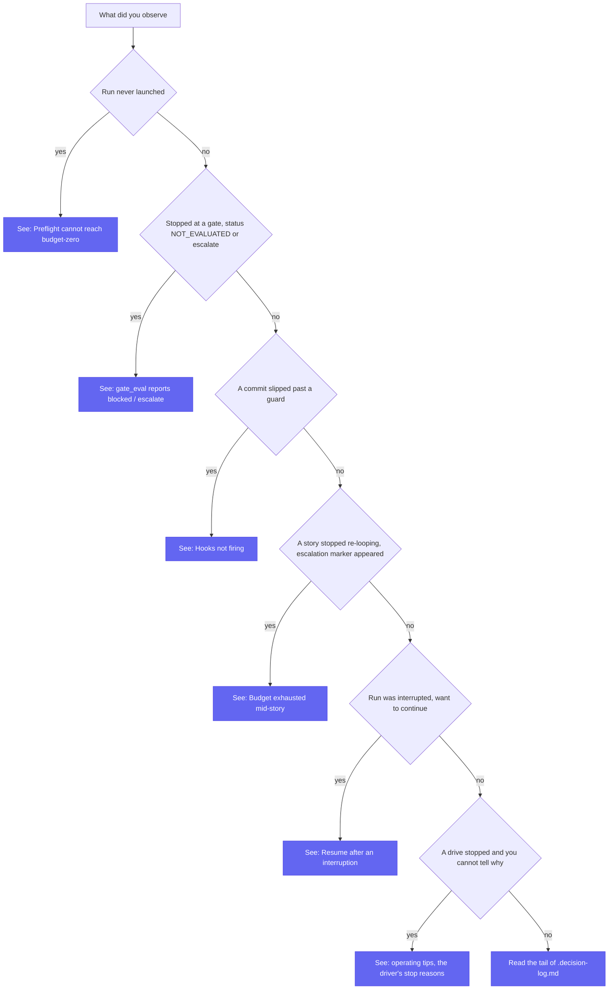

Real failure modes, sourced from the skill's stage files and scripts, with what the run does about each and what you do. For the design behind these behaviors see [how it works](./how-it-works.md), [the gate model](./gate-model.md), and [architecture](./architecture.md).

For the operator's side of a run that is technically working and still not doing what you meant, see [operating tips](./operating-tips.md). It covers the driver stop reasons that need a decision, why row order is the only sequencing mechanism, and the verification traps that produce confident false greens.

Start from the symptom you observed and follow it to the section that explains it:

## Preflight can't reach budget-zero

**Symptom.** The run stops at Stage 2 (or, headless, emits `{"status":"blocked", ...}` with a one-line `reason`) and never launches.

**What happened.** Preflight is a hard gate: the run launches only when the post-remediation mechanical `budget == 0` **and** the semantic scan found no RED. The auto-remediation pass clears the *fixable* mechanical blockers: it scaffolds the test framework, generates missing acceptance criteria, pre-creates the TEA output dirs, ensures `sprint-status.yaml`, and prompts once (interactively) for secrets, then re-runs the check. The `project-context.md` count is advisory: preflight de-duplicates more than one, logs a missing one, and never blocks on it.

**What stays red.** Some things the remediation pass cannot fix, by design:

- **Undecided product or architecture decisions.** An open question, a "TBD"/"TODO: decide" on a load-bearing requirement, a PRD↔ADR contradiction, or a story whose "done" is undefinable. The fix is a human decision; an unattended run guessing it produces confidently wrong work. Resolve the decision in the artifacts, then re-run.
- **Missing secrets in headless.** Headless never prompts, so a secret that cannot be resolved becomes a RED blocker rather than a question. Provide the secret (out of git) before the headless run, or run attended so preflight can prompt once.
- **Claude Code below the minimum versions.** The primitive-version blocker is marked non-remediable: the script can't upgrade the host. Update Claude Code.
- **A repository with nothing committed.** On a fresh `git init` (or an orphan branch) the `git_unborn` blocker is non-remediable: the run never makes the commit its Epic branch would start from, because that commit would sit outside its only rollback, the Epic branch. Commit a baseline yourself (the BMAD install, the planning artifacts and the project skeleton) on your base branch, a protected branch such as `main` and never an Epic branch, then re-run. If HEAD already names an Epic branch, the blocker's detail gives the command that points it at the base first.
- **A refused settings write.** Preflight writes its hooks and allow rules into `.claude/settings.local.json`, which Claude Code treats as protected. Under Auto Mode the permission classifier may refuse that write, or let it land and refuse the next calls, as self-modification. The run then stops rather than work around the refusal, and the decision log names the write. Attended, approve it under `/permissions` (on its Recently denied tab) or apply it yourself; the run re-checks the hooks and continues. Headless, there is nobody to approve it, and `/ucg-resolve` is not the way back: take the Epic through preflight attended (see [hook security](./getting-started.md#hook-security)).
- **Story skills not installed.** The run delegates story creation to `ucg-create-story` and implementation to `ucg-dev-story`, the story skills UCG ships in place of BMAD Method's deprecated `bmad-create-story` and `bmad-dev-story`. UCG's installer copies them beside the `ultracode-goal` skill, so a missing one means a partial or older UCG install, or an install from the plugin marketplace alone, which ships only the `ultracode-goal` skill. The `story_skills` blocker is non-remediable: the run neither installs them nor works around them. Its detail names the fix, `npx bmad-module-ultracode-goal update` from the project root (`install` where UCG was never installed there). BMAD's own shims, installed with `--shims`, do not satisfy it (see [Prerequisites](./getting-started.md#prerequisites)). The same check runs on every resume, so a story skill deleted mid-Epic, by hand or by an install interrupted while it re-copies the UCG skills, stops the next spawn instead of letting it improvise.
- **TEA skills not installed.** The run delegates test design, acceptance tests, review and the gate to TEA's `bmad-testarch-*` skills. Production needs all eight. `--light` needs three: `bmad-testarch-framework`, `bmad-testarch-test-design` and `bmad-testarch-trace`. The `tea_skills` blocker is non-remediable: the run never installs TEA. UCG supports BMAD 6 with TEA 1.27.x, which BMAD Method 6.12.2 and later install. Add or repair TEA from the project root with `npx bmad-method install`, with the `tea` module selected, then re-run. If the detail says it found `bmad-tea-*` skills instead, the project has TEA 3.0 or later, which renamed the skills UCG calls. UCG does not support it yet: install TEA 1.27.x through BMAD 6 instead (see [Prerequisites](./getting-started.md#prerequisites)). Preflight checks skill names, not the TEA version. TEA 2.x moved to BMAD 7's module format but kept the `bmad-testarch-*` names, so preflight does not catch it, though UCG does not support it either. Preflight checks these skills at launch only. A TEA skill removed mid-Epic escalates the story that calls it.

The decision log carries the full blocker list with what each needs to clear. Read it, clear the items, re-run.

## gate_eval reports blocked / escalate on a missing gate-decision.json

**Symptom.** Stage 5 returns `gate_status: NOT_EVALUATED` and verdict `escalate`, with a `reasons` entry like `neither gate-decision.json nor e2e-trace-summary.json present in <dir>`.

**What happened.** `gate_eval.py` reads TEA's gate artifact from the trace output directory. `NOT_EVALUATED` means neither the slim `gate-decision.json` nor the fallback `e2e-trace-summary.json` was found there, or the run carried no gate fields. Almost always this is one of:

- **The TEA trace gate did not run.** In production, Stage 5 must backfill evidence first (`bmad-testarch-automate` → `bmad-testarch-trace` → `bmad-testarch-nfr`) before the gate; `bmad-testarch-trace` is what writes the gate decision. If it didn't run, there is nothing to read.
- **Wrong `trace_output_dir`.** The script reads the directory passed as `--trace-output` (resolved from `{workflow.trace_output_dir}`). If TEA wrote elsewhere, or the output dirs were never pre-created at preflight, the artifact is real but in a different place. Confirm `trace_output_dir` matches where TEA actually wrote.

Note this is fail-closed on purpose: a missing or unreadable gate artifact escalates rather than being assumed green. The slim file's *absence alone* is not the problem: the script falls back to the summary, and that fallback is explicitly not a failure. See the [gate model](./gate-model.md) for how the artifact resolves into a `gate_status` and the full verdict mapping.

## Gate re-loops on a sweep-scope or delta cap

A per-story gate can return `reloop` with a `PASS` gate status when a cap fired rather than a finding: the `reasons` name either the sweep-scope cap (the `.tests-ran` marker says `scope=scoped`, or the marker/`scope=` line is missing) or the delta-profile cap (`--cycle-profile delta` was declared). Neither is an error; both mean "not yet, and here is why": a story only advances off a full-scope sweep judged by the full gate instrument. The remedy is the cap-only re-loop, which skips the generalize ceremony entirely: re-run the full three-axis sweep, refresh the marker with `scope=full`, and re-run the gate without `--cycle-profile`. See the cap sections in the [gate model](./gate-model.md).

## Hooks not firing

**Symptom.** A commit lands on a protected branch, or a commit lands before a story's tests ran: the invariants the PreToolUse hook should enforce did not block.

**What to check.**

- **Older Claude Code.** The hook returns a `deny` decision in the hook JSON and *also* exits 2 with the reason on stderr precisely so older clients that ignore the JSON still block. If neither path fired, the client may not be honoring PreToolUse hooks at all. Update Claude Code.
- **`settings.local.json` not merged.** The hooks are merged into `{project-root}/.claude/settings.local.json` at preflight, and the skill asserts they are active before going unattended. If the file wasn't merged (or the workspace trust dialog wasn't accepted), the hooks aren't loaded. Re-run preflight; verify the two hook entries are present in the resolved settings.
- **A `customize.toml` override that silently no-ops.** Both hooks read config from env first and fall back to hardcoded defaults (`main`/`master`, `25`, `ultracode/epic-`). A `protected_branches` or turn-budget override in `customize.toml` only reaches the hook if preflight injected it into the hook env (`ULTRACODE_PROTECTED_BRANCHES`, etc.). If your custom protected branch isn't being guarded, the override didn't reach the enforcement layer. Confirm preflight passed it through.

## Budget exhausted mid-story

**Symptom.** A story stops re-looping; an escalation marker (`<impl-artifacts>/.escalation-<story>.md`) appears; the run surfaces a budget message.

**What happened.** Three layers can bound a runaway story. The literal "…or stop after N turns" clause inside a `/goal` condition binds only when you started a `/goal` whose own condition carries it, and then it bounds the session: the conductor cannot start one itself. Otherwise the bound is the gate's re-loop budget: before each re-loop the conductor reads the hook's recorded turn count, and a `reloop` that would exceed `max_turns_per_story` becomes an `escalate` instead. That count advances once per response, so re-loops spent inside one response do not move it, and for `drive_epic.py` spawns the `--session-timeout` wall clock is the backstop. The **Stop** hook (`budget_stop.py`) is the defensive third layer: it counts turns and, on overrun, writes the escalation marker and lets the stop proceed. The marker records the count and does not stop the drive, so the story goes on toward its gate. It becomes an escalation only when the gate escalates the story on that count. A story that passes its gate gets a sizing note in the decision log and the run report instead: no escalation, no ping, and nothing left open.

**Its documented limitation.** A Stop hook fires only when Claude is *already* trying to stop: it **cannot interrupt a `/goal` condition mid-turn**. So at this layer the ceiling is advisory; what can stop the story is the conductor's re-loop budget checked against this count, plus the in-condition turn clause when you started a `/goal`. In a single attended or `-H` session with no `/goal` of yours, nothing bounds re-loops spent inside one response; only `drive_epic.py` spawns have a hard backstop, their `--session-timeout` (unless set to `0`). If a story keeps consuming budget, that is the signal to re-scope, split, or hand it off, not to raise the budget and hope.

## Resume after an interruption

**Symptom.** A run was interrupted (Ctrl-C, a crash, a compaction) and you want to continue rather than restart.

**What happens.** The run's `.decision-log.md` is canonical memory and recovers full state regardless of compaction. On resume the skill surfaces the existing log with its last session date and offers to resume. Execute re-enters at the **first story whose last logged gate verdict is not `advance`**; already-advanced stories are not re-run. The Epic branch, hooks, and allowlist are **re-asserted, not rebuilt**, before continuing. You do not need to reconstruct state by hand. Point the skill at the same Epic and accept the resume offer.

## The retired `--parallel` flag

`--parallel` (the experimental worktree fan-out) is retired. The flag is still accepted so an old invocation does not error: the run logs one `.decision-log.md` note that it was accepted and ignored, then executes the sequential spine. The Epic still ships; it ships sequentially. `parallel_max_concurrency` in `customize.toml` is likewise deprecated and no-op.
