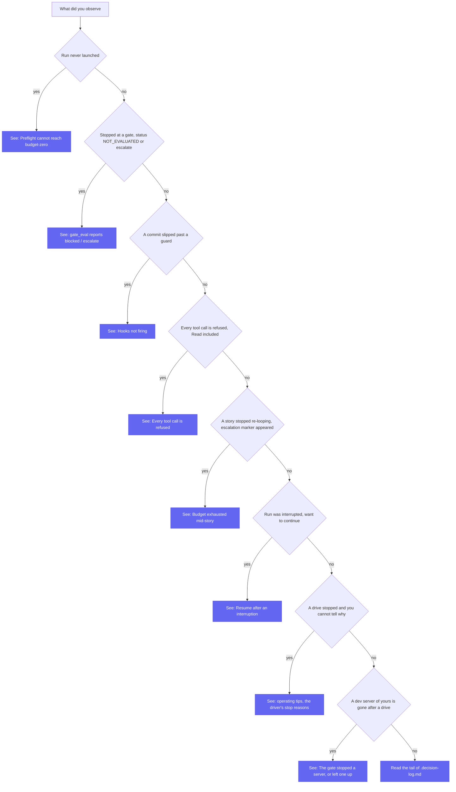

Real failure modes, sourced from the skill's stage files and scripts, with what the run does about each and what you do. For the design behind these behaviors see [how it works](./how-it-works.md), [the gate model](./gate-model.md), and [architecture](./architecture.md).

For the operator's side of a run that is technically working and still not doing what you meant, see [operating tips](./operating-tips.md). It covers the driver stop reasons that need a decision, why row order is the only sequencing mechanism, and the verification traps that produce confident false greens.

Start from the symptom you observed and follow it to the section that explains it:

## Preflight can't reach budget-zero

**Symptom.** The run stops at Stage 2 (or, headless, emits `{"status":"blocked", ...}` with a one-line `reason`) and never launches.

**What happened.** Preflight is a hard gate: the run launches only when the post-remediation mechanical `budget == 0` **and** the semantic scan found no RED. The auto-remediation pass clears the *fixable* mechanical blockers: it scaffolds the test framework, generates missing acceptance criteria, pre-creates the TEA output dirs, ensures `sprint-status.yaml`, and prompts once (interactively) for secrets, then re-runs the check. The `project-context.md` count is advisory: preflight de-duplicates more than one, logs a missing one, and never blocks on it.

**What stays red.** Some things the remediation pass cannot fix, by design:

- **Undecided product or architecture decisions.** An open question, a "TBD"/"TODO: decide" on a load-bearing requirement, a PRD↔ADR contradiction, or a story whose "done" is undefinable. The fix is a human decision; an unattended run guessing it produces confidently wrong work. Resolve the decision in the artifacts, then re-run.
- **Missing secrets in headless.** Headless never prompts, so a secret that cannot be resolved becomes a RED blocker rather than a question. Provide the secret (out of git) before the headless run, or run attended so preflight can prompt once.
- **Claude Code below the minimum versions.** The primitive-version blocker (`cc_version`) is marked non-remediable: the script can't upgrade the host. It names each primitive the version lacks. 2.1.295 is the floor, the release that added the hook setting `"onFailure": "block"` the guard is armed with. Update Claude Code (`claude update`). A run already in flight meets the same floor when it resumes: the resume runs `claude --version`, and below 2.1.295 it escalates the story it was about to drive instead of driving it. Update Claude Code, then resume in a new session, since an update takes effect only when Claude Code next starts: the resume shows that escalation and offers `/ucg-resolve` to close it (headless, run `/ucg-resolve` first). On a run UCG 3.x armed, that resume is also the one that re-arms the hooks, a write to `.claude/settings.local.json`: make it attended, since a headless one may be refused the write (see "A refused settings write" below). Both checks run the `claude` first on `PATH`, not the binary the session runs on. With two installs (an npm one beside the native installer's, say), or a `drive_epic.py --claude-bin` that names another binary, update the one first on `PATH` too, or the check reads its older version.
- **A repository with nothing committed.** On a fresh `git init` (or an orphan branch) the `git_unborn` blocker is non-remediable: the run never makes the commit its Epic branch would start from, because that commit would sit outside its only rollback, the Epic branch. Commit a baseline yourself (the BMAD install, the planning artifacts and the project skeleton) on your base branch, a protected branch such as `main` and never an Epic branch, then re-run. If HEAD already names an Epic branch, the blocker's detail gives the command that points it at the base first.
- **A refused settings write.** Preflight writes its hooks and allow rules into `.claude/settings.local.json`, which Claude Code treats as protected. Under Auto Mode the permission classifier may refuse that write, or let it land and refuse the next calls, as self-modification. The run then stops rather than work around the refusal, and the decision log names the write. Attended, approve it under `/permissions` (on its Recently denied tab) or apply it yourself; the run re-checks the hooks and continues. Headless, nobody is there to approve a refused write. At preflight the run then stops, and `/ucg-resolve` is not the way back: take the Epic through preflight attended (see [hook security](./getting-started.md#hook-security)). A resume rewrites the file too when the hooks need re-arming (the first resume after an update to 4.x does, unless it first escalates a reason that is yours to fix, such as a Claude Code older than 2.1.295), and a headless resume whose write is refused escalates the story it was about to drive instead. Resume attended: make or approve the write it asks for, and close that escalation with `/ucg-resolve`, which the resume offers before it drives the story. Whether a headless session is refused the write depends on its permission mode: under `bypassPermissions` the write lands, under Auto Mode the classifier decides, and under `default`, `acceptEdits` (the mode `drive_epic.py` spawns in unless you pass another) or `dontAsk` it is refused, since a write to a protected file needs an approval nobody is there to give.
- **Story skills not installed.** The run delegates story creation to `ucg-create-story` and implementation to `ucg-dev-story`, the story skills UCG ships in place of BMAD Method's deprecated `bmad-create-story` and `bmad-dev-story`. UCG's installer copies them beside the `ultracode-goal` skill, so a missing one means a partial or older UCG install, or an install from the plugin marketplace alone, which ships only the `ultracode-goal` skill. The `story_skills` blocker is non-remediable: the run neither installs them nor works around them. Its detail names the fix, `npx bmad-module-ultracode-goal update` from the project root (`install` where UCG was never installed there). BMAD's own shims, installed with `--shims`, do not satisfy it (see [Prerequisites](./getting-started.md#prerequisites)). The same check runs on every resume, so a story skill deleted mid-Epic, by hand or by an install interrupted while it re-copies the UCG skills, stops the next spawn instead of letting it improvise.
- **TEA skills not installed.** The run delegates test design, acceptance tests, review and the gate to TEA's `bmad-testarch-*` skills. Production needs all eight. `--light` needs three: `bmad-testarch-framework`, `bmad-testarch-test-design` and `bmad-testarch-trace`. The `tea_skills` blocker is non-remediable: the run never installs TEA. UCG supports BMAD 6 with TEA 1.27.x, which BMAD Method 6.12.2 and later install. Add or repair TEA from the project root with `npx bmad-method install`, with the `tea` module selected, then re-run. If the detail says it found `bmad-tea-*` skills instead, the project has TEA 3.0 or later, which renamed the skills UCG calls. UCG does not support it yet: install TEA 1.27.x through BMAD 6 instead (see [Prerequisites](./getting-started.md#prerequisites)). Preflight checks skill names, not the TEA version. TEA 2.x moved to BMAD 7's module format but kept the `bmad-testarch-*` names, so preflight does not catch it, though UCG does not support it either. Preflight checks these skills at launch only. A TEA skill removed mid-Epic escalates the story that calls it.

- **This session does not run the hooks.** Preflight's last arming step proves that the session runs the hooks it wrote, and stops before the launch when it does not. See [Hooks not firing](#hooks-not-firing).

The decision log carries the full blocker list with what each needs to clear. Read it, clear the items, re-run.

## gate_eval reports blocked / escalate on a missing gate-decision.json

**Symptom.** Stage 5 returns `gate_status: NOT_EVALUATED` and verdict `escalate`, with a `reasons` entry like `neither gate-decision.json nor e2e-trace-summary.json present in <dir>`.

**What happened.** `gate_eval.py` reads TEA's gate artifact from the trace output directory. `NOT_EVALUATED` means neither the slim `gate-decision.json` nor the fallback `e2e-trace-summary.json` was found there, or the run carried no gate fields. Almost always this is one of:

- **The TEA trace gate did not run.** In production, Stage 5 must backfill evidence first (`bmad-testarch-automate` first and alone, then the commit of any test it backfilled, then `bmad-testarch-trace` and `bmad-testarch-nfr`) before the gate; `bmad-testarch-trace` is what writes the gate decision. If it didn't run, there is nothing to read.
- **Wrong `trace_output_dir`.** The script reads the directory passed as `--trace-output` (resolved from `{workflow.trace_output_dir}`). If TEA wrote elsewhere, or the output dirs were never pre-created at preflight, the artifact is real but in a different place. Confirm `trace_output_dir` matches where TEA actually wrote.

Note this is fail-closed on purpose: a missing or unreadable gate artifact escalates rather than being assumed green. The slim file's *absence alone* is not the problem: the script falls back to the summary, and that fallback is explicitly not a failure. See the [gate model](./gate-model.md) for how the artifact resolves into a `gate_status` and the full verdict mapping.

## Gate re-loops on a sweep-scope or delta cap

A per-story gate can return `reloop` with a `PASS` gate status when a cap fired rather than a finding: the `reasons` name either the sweep-scope cap (the `.tests-ran` marker says `scope=scoped`, or the marker/`scope=` line is missing) or the delta-profile cap (`--cycle-profile delta` was declared). Neither is an error; both mean "not yet, and here is why": a story only advances off a full-scope sweep judged by the full gate instrument. The remedy is the cap-only re-loop, which skips the generalize ceremony entirely: re-run the full three-axis sweep, refresh the marker with `scope=full`, and re-run the gate without `--cycle-profile`. See the cap sections in the [gate model](./gate-model.md).

## The gate stopped a server, or left one up

**Symptom.** A dev server you had running is gone after a drive, or the decision log's worktree line names a server the gate stopped, or one it left up.

**What happened.** A test runner such as Playwright starts a server through a launcher such as turbo, which runs it in a process group of its own, so the server outlives the run. Execute's sweep right before the gate leaves one up in the main tree that way, and so does a gate run. On Linux the gate stops such a server with `scripts/probe_servers.py` at each of its checks, and once more when the story's gate ends, so the gate's runs in its worktree do not reuse it and those servers do not pile up over an Epic. It stops a server only when every process of it is yours, has no controlling terminal and started after the story's `.baseline-<story_id>` marker was written, the process that started its session has exited, nothing else that still runs in that session started before the marker or is the parent of one of its processes (a watcher or supervisor that can start it again), and it runs from the project or the gate's worktree. It leaves every other server up, and its `left` list gives the reason; on macOS and Windows it stops nothing. The gate never stops a server any other way.

**What you do.** If it stopped a server of yours, that server met every condition: it started inside the project, on a port the gate checks and after the story's marker was written, it had no terminal and had outlived the command that started its session, as a server does that a script or another agent session starts in the background, or one you start with `nohup ... &` from a terminal you then close, and nothing that began before the marker still ran in its session. A watcher or supervisor of yours that starts the server again after the marker (on a file change the run makes, say) keeps it up only while it runs in the server's session and either began before the marker or is the parent of one of the server's processes from a process group of its own; the server reads as the run's when the watcher began after the marker and either runs in the server's process group or starts it through a command that then exits and is not its parent afterwards (a subreaper adopts it back), or, whenever the watcher began, when that command gave the server a session of its own. That marker is written when the story starts, and the resume of a stopped or blocked run keeps it, so it can be days old: a server you start between a run and its resume counts too. Start it again, and stop such a server before you start or resume a drive, or start it outside the project, on another port or from a terminal you keep open. A server it left up keeps its port, so the gate gives the worktree's runs a server of their own through a scratch runner config where it can, and otherwise tells each assessor what that server leaves unmeasured. When the run left that server up, stop it yourself once the drive is done: a runner killed before it could end its start command leaves one whose session's first process still runs, and a watcher the run's own start command runs (a launcher task that runs watchexec, cargo-watch or air, say) keeps up the server it runs in a process group of its own, as a watcher of yours does, so stop that watcher too. A drive that stops before a story's gate logs its verdict can leave one up as well: that story's next gate stops it when you resume the run, so stop it yourself only if you do not resume.

## Hooks not firing

**Symptom.** A commit lands on a protected branch, or a commit lands before a story's tests ran: the invariants the PreToolUse hook should enforce did not block. Or preflight stops before the launch, saying the hooks are in `.claude/settings.local.json` and this session does not run them.

**What to check.**

- **Older Claude Code.** The hook returns a `deny` decision in the hook JSON and *also* exits 2 with the reason on stderr precisely so older clients that ignore the JSON still block. If neither path fired, the client may not be honoring PreToolUse hooks at all. Update Claude Code.
- **`settings.local.json` not merged.** The hooks are merged into `{project-root}/.claude/settings.local.json` at preflight. Before going unattended, preflight checks the file, then proves this session runs them with one `git commit --dry-run` that the guard must refuse. If the file wasn't merged (or the workspace trust dialog wasn't accepted), the hooks aren't loaded. Re-run preflight; verify the two hook entries are present in the resolved settings.
- **Hooks written while the session ran, and not loaded.** Preflight writes the hooks while Claude Code runs, and Claude Code's file watcher normally picks that edit up but can miss it. Preflight's probe catches this: its `git commit --dry-run` creates no commit, a guard the session runs refuses it with `Tests-ran guard: refusing` and `current story (unknown)`, and when it is not refused twice, preflight stops. Attended, it asks you to quit Claude Code and resume the conversation with ultracode effort and Auto Mode on, as you launched it, since a resumed session takes the effort and the mode its launch sets, and then to say continue: `claude --continue --effort ultracode --permission-mode auto` in the project resumes the most recent conversation, `claude --resume` with the same two flags lets you pick this one when another in the project is more recent, or reopen it in the desktop app. The resumed session reads the file as it starts. When either setting is off there, preflight names it and asks you to turn it on and say continue. A headless run stops with a RED blocker: invoke it again, since a new session reads the file as it starts. In the session, `/hooks` lists the hooks it loaded.
- **A setting that keeps the file's hooks from running.** When a resumed or a new session still does not refuse the probe, something other than the file watcher keeps the hooks from running: `disableAllHooks` set in another settings layer or in a `--settings` file, `allowManagedHooksOnly` in managed settings, a `--setting-sources` that leaves out `local`, or `--bare`, which skips hooks. Clear it, check that `/hooks` lists the guard, then invoke the run again.
- **A story set in Claude Code's environment.** A guard that runs can also let the probe through: with `ULTRACODE_STORY_ID` in the environment Claude Code runs hooks with, naming a story whose tests-ran marker is fresh, and something staged, the guard allows the call, and preflight reads that as a session that does not run the hooks. Unset the variable where you start Claude Code, start it again, then invoke the run again.
- **The probe refused for another reason.** Any guard reason other than `Tests-ran guard: refusing` with `current story (unknown)` means a guard runs but reads a story or a branch this run did not set: an `ULTRACODE_STORY_ID` in the environment Claude Code runs hooks with, or a guard from an earlier arming still loaded with another implementation-artifacts folder. For the variable, unset it where you start Claude Code, then start Claude Code again; for an earlier arming, quit and start Claude Code again so it loads the file this run wrote. Then invoke the run again.
- **A refusal from another hook.** A probe result that names another hook's command in brackets and holds no guard reason, such as `PreToolUse:Bash hook error: [<its command>]: <its stderr>`, is that hook's refusal, so the guard did not refuse the call. Check `/hooks` for the guard, as the bullets above say.
- **A `customize.toml` override that silently no-ops.** Both hooks read config from env first and fall back to hardcoded defaults (`main`/`master`, `25`, `ultracode/epic-`). A `protected_branches` or turn-budget override in `customize.toml` only reaches the hook if preflight injected it into the hook env (`ULTRACODE_PROTECTED_BRANCHES`, etc.). If your custom protected branch isn't being guarded, the override didn't reach the enforcement layer. Confirm preflight passed it through.

## Every tool call is refused

**Symptom.** Every tool call the session makes is refused, Read, Edit and Bash alike, and each refusal names the guard's command, `guard_pretooluse.py`. Most read like `PreToolUse:Bash hook error: [<command>]: failed; blocking because onFailure is "block"` (or `timed out; blocking because onFailure is "block"`). When `uv` itself refuses to start the script (the skill was moved or removed, or no Python it can use), the refusal shows `uv`'s own error instead, such as `error: Failed to spawn`, since `uv` then exits 2, which Claude Code reads as a refusal in any case. A headless run stops on the first call.

**What happened.** Preflight arms the PreToolUse guard with `"onFailure": "block"`, so when the guard cannot run, Claude Code refuses the call rather than letting it through unchecked. The guard's matcher covers every tool, so a guard that cannot run refuses every call, including the ones the session would need to repair it. The usual causes:

- **`uv` is not on the `PATH` Claude Code runs hooks with.** The guard runs as `uv run …`, and a shell that cannot find `uv` exits 127. A session started from a shell or launcher with a narrower `PATH` than the one preflight ran in hits this.
- **The skill was moved or removed.** The guard's command names the script by the path the skill was installed at; an uninstall, or a reinstall to another folder, leaves the command pointing at nothing. When the project, or a folder above it, holds a `pyproject.toml`, `uv run` syncs that project on every call before it finds the script missing: it creates the project's `.venv` and `uv.lock` on the first call and builds the project again whenever it changes, and the refusal can show that project's build error instead of `Failed to spawn`. The budget hook's command points at nothing too. `uv` exits 2 when it cannot find the script, which on a `Stop` hook Claude Code reads as a block: each time the session tries to stop, it is sent back with uv's error instead, up to eight times in a row, after which Claude Code lets the stop through (the count starts again whenever Claude calls a tool). When that project fails to build, or its requirements cannot be satisfied, `uv` stops there and exits 1, which Claude Code reads on a `Stop` hook as a non-blocking error: the session stops, and the turn goes uncounted. A network failure in that sync exits 2 instead, and each stop is sent back as above. Reinstalling the skill ends it; then delete a `.venv` or `uv.lock` those calls left in a project that had none.
- **A path with a space, left unquoted in the command.** Claude Code runs the guard's command through a shell, which splits it at every unquoted space. Preflight writes each injected value and the script path in single quotes, so a project or skill folder whose path holds a space (`~/My Projects/app`, say) stays one word. A command written without them hands the rest of that path to the shell as the command to run, and the message names it: `/bin/sh: 1: Projects/app/_bmad-output/implementation-artifacts: not found` on Linux, or the same path followed by `No such file or directory` on macOS.
- **No Python `uv` can use.** `uv` cannot start a Python the script's header allows.
- **The guard ran past its timeout.** Claude Code's default for a command hook is 600 seconds; the message then says `timed out`.

A refusal the guard makes itself reads differently: in place of `[<command>]: failed; blocking`, it carries the guard's own reason (`Commit/push guard: …`, `Protected-branch guard: …`, `UltraCode-Goal guard: …`) and names what to fix. That is the guard deciding, not failing.

**What you do.** Fix it from outside the session, since the session cannot run a tool:

1. Run the guard's command from `.claude/settings.local.json` yourself, in a terminal, to see why it fails (`echo '{}' | <the command>` should exit 0 and print nothing).
2. Fix what it shows: put `uv` on `PATH`, reinstall the skill (`npx bmad-module-ultracode-goal update`), install a Python the script allows, or put each injected value and the script path in single quotes (`KEY='value' uv run '<path>'`), in the Stop budget hook's command too. From the project root, `uv run '<the skill folder>/scripts/preflight_check.py' --assert-armed --project-root . --impl-artifacts _bmad-output/implementation-artifacts` names every UCG hook command the shell would split (pass your own artifacts folder if you moved it).
3. Then resume the run. The resume re-checks the hooks and re-arms them if they need it, unless it also finds a reason that is yours to fix, a missing story skill or a Claude Code older than 2.1.295: it then escalates the story it was about to drive first, and re-arms the hooks on the resume after you fix that.

If you need the session working before you can fix the cause, remove the guard's item from `.claude/settings.local.json` by hand, as [SECURITY.md](https://github.com/armelhbobdad/bmad-module-ultracode-goal/blob/main/SECURITY.md) describes under "How to remove them". The session then runs with no guard at all, and a resume or the next preflight puts the item back, so fix the cause before either.

## Budget exhausted mid-story

**Symptom.** A story stops re-looping; an escalation marker (`<impl-artifacts>/.escalation-<story>.md`) appears; the run surfaces a budget message.

**What happened.** Three layers can bound a runaway story. The literal "…or stop after N turns" clause inside a `/goal` condition binds only when you started a `/goal` whose own condition carries it, and then it bounds the session: the conductor cannot start one itself. Otherwise the bound is the gate's re-loop budget: before each re-loop the conductor reads the hook's recorded turn count, and a `reloop` that would exceed `max_turns_per_story` becomes an `escalate` instead. That count advances once per response, so re-loops spent inside one response do not move it, and for `drive_epic.py` spawns the `--session-timeout` wall clock is the backstop. It counts responses, not work: a background task's notification that lands while the session is idle starts a response of its own, which counts the same as one that edits code, so a story whose sweeps, reviews and gate assessors run in the background can reach the ceiling on waiting. Execute keeps that small by making each wait report once, and by starting no other story's work while a story is current. The **Stop** hook (`budget_stop.py`) is the defensive third layer: it counts turns and, on overrun, writes the escalation marker and lets the stop proceed. The marker records the count and does not stop the drive, so the story goes on toward its gate. It becomes an escalation only when the gate escalates the story on that count. A story that passes its gate gets a sizing note in the decision log and the run report instead: no escalation, no ping, and nothing left open.

**Its documented limitation.** A Stop hook fires only when Claude is *already* trying to stop: it **cannot interrupt a `/goal` condition mid-turn**. So at this layer the ceiling is advisory; what can stop the story is the conductor's re-loop budget checked against this count, plus the in-condition turn clause when you started a `/goal`. In a single attended or `-H` session with no `/goal` of yours, nothing bounds re-loops spent inside one response; only `drive_epic.py` spawns have a hard backstop, their `--session-timeout` (unless set to `0`). If a story keeps consuming budget, that is the signal to re-scope, split, or hand it off, not to raise the budget and hope.

## Resume after an interruption

**Symptom.** A run was interrupted (Ctrl-C, a crash, a compaction) and you want to continue rather than restart.

**What happens.** The run's `.decision-log.md` is canonical memory and recovers full state regardless of compaction. On resume the skill surfaces the existing log with its last session date and offers to resume. Execute re-enters at the **first story whose last logged gate verdict is not `advance`**; already-advanced stories are not re-run. The Epic branch, hooks, and allowlist are **re-asserted, not rebuilt**, before continuing. You do not need to reconstruct state by hand. Point the skill at the same Epic and accept the resume offer. One case stops instead: when the story it would re-enter still has an open escalation (its `escalation-<story_id>.json` on disk, not closed by `/ucg-resolve`), the run drives nothing and points you at `/ucg-resolve`; a headless run ends `blocked` with a `reason` naming the sidecar. Answer it there, then resume. When the answered escalation was `operator-evidence-owed`, the resume then re-gates the commit your records were made at instead of re-driving the story, as long as nothing was committed after it.

## The retired `--parallel` flag

`--parallel` (the experimental worktree fan-out) is retired. The flag is still accepted so an old invocation does not error: the run logs one `.decision-log.md` note that it was accepted and ignored, then executes the sequential spine. The Epic still ships; it ships sequentially. `parallel_max_concurrency` in `customize.toml` is likewise deprecated and no-op.
